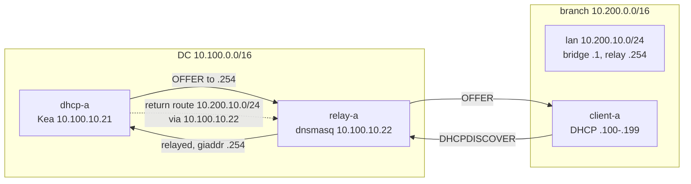

# s2-dhcp: Relayed DHCP and a Surviving Lease: Implementation Plan

> **For agentic workers:** REQUIRED SUB-SKILL: Use superpowers:subagent-driven-development (recommended) or superpowers:executing-plans to implement this plan task-by-task. Steps use checkbox (`- [ ]`) syntax for tracking.

**Goal:** Prove that a DHCP client on a branch segment acquires a lease through a relay, and keeps that lease across a Kea restart, a relay restart and a client reboot.

**Architecture:** One new `modules/dhcp` module ships two profiles. The `server` profile runs Kea on the DC management segment. The `relay` profile runs dnsmasq with `--dhcp-relay` on the branch segment. A new `client` role is `FROM core` with no packages; its branch interface asks for DHCP and its management interface stays static. The lab renderer emits the Kea configuration, the relay configuration and the cloud-init network configuration into the NoCloud seed, so no image carries a lab address. The lease store is Kea's memfile under `/var/lib/kea`.

**Tech Stack:** CentOS Stream 10 image mode, bootc, Podman, image-builder, Kea 3.0.3, dnsmasq 2.90, NetworkManager 1.58, libvirt/KVM, Python 3.11+ stdlib (`tomllib`, `dataclasses`, `ipaddress`, `json`), bash test harness.

**Spec:** `docs/superpowers/specs/2026-11-26-ultus-corp-design.md`

**Work item:** [#16](https://github.com/ultus-net/ultus-corp/issues/16)

## Status, 2026-11-27

Nothing is built. The checkboxes below are the plan's step syntax, not its
progress record. This table is the progress record.

| Task | State | Evidence |
| --- | --- | --- |
| 1 spec model, cross-site interfaces, DHCP client mode | pending | `python3 -m unittest tests.test_render` |
| 2 shared deployment gate and shared provision unit | pending | `bash tests/test-greenboot.sh` |
| 3 dhcp role: Kea server and dnsmasq relay | pending | `bash tests/test-dhcp.sh`, `bash tests/test-image.sh dhcp` |
| 4 client role | pending | `bash tests/test-client.sh`, `bash tests/test-image.sh client` |
| 5 s2 scenario, design deltas, runbook, CI | pending | `bash tests/test-static.sh`, `bash tests/test-ci.sh` |
| 6 hypervisor evidence run | blocked on the rootful disk build | `run/evidence/s2-dhcp.log` |

Tasks 1 to 5 land in one implementation PR linked to #16. Task 6 runs on the
same branch before merge, because the scenario is the increment's acceptance
test. The plan itself is the requested docs-only PR that precedes that work.

## Global Constraints

- The scenario is 3 VMs and 3072 MiB, below the five-VM and 10 GiB ceilings.
- Base image: the digest-pinned `centos-bootc:stream10` in `manifests/base.txt`. Every role is `FROM` the core digest in `manifests/core.txt`.
- `dhcp` installs `kea` and `dnsmasq` from a checked-in lock. `client` adds no package, so it has no package manifest and no lock.
- No image ships a rendered configuration. The renderer writes the Kea file, the relay file and the network configuration into the seed. `provision.sh` applies them unchanged.
- A node's role and profile select behaviour. `dhcp` requires `profile = "server"` or `profile = "relay"`. Any other role rejects `profile`.
- `mode = "dhcp"` is allowed only on a `client` role, and never on a node's first interface. `lab up` reads `node.interfaces[0].address` into `info["address"]` (`lab/lab:268`) and waits for the deployment record there (`lab/lab:169-183`), so that address is always static.
- The relay never serves DHCP itself and never answers DNS. Its dnsmasq config sets `port=0` and only `dhcp-relay`.
- Kea's subnet omits the `routers` option. The client keeps the management interface's default route until s3 gives the branch edge a gateway.
- The lease store is `/var/lib/kea/kea-leases4.csv`. Backup and restore stay with the D20 gate; this increment only proves the store survives a restart.
- No DDNS, reservations, DHCP option 6, nftables, overlay, backup or restore. Those belong to s3 and later.
- One logical change per commit, with subjects using `feat:`/`fix:`/`refactor:`/`docs:`/`test:`/`chore:`.
- `CHANGELOG.md` and the affected `docs/` pages ship in the same commit as the behaviour they describe.

## Platform evidence

Facts this plan depends on, read on 2026-11-27 from the built `dns` image and
the Stream 10 repositories. A failing fact here is a plan bug.

| Fact | Value | Where it was checked |
| --- | --- | --- |
| Kea version | `kea-3.0.3-1.el10.x86_64`, BaseOS | `rpm -q kea` in `localhost/ultus-corp/dns:local` |
| Kea config check | `kea-dhcp4 -t <file>` exits 0 on a valid file | probe, `kea-dhcp4 -t /tmp/kea.conf` |
| Kea subnet id | `subnet4[].id` is required | probe, config rejected without it |
| Kea control socket | absolute `/var/run/kea/kea4-ctrl-socket` is accepted | probe, `ls -l /var/run/kea/kea4-ctrl-socket` |
| Kea control protocol | raw JSON over a Unix stream socket, newline terminated, no HTTP | probe, `curl` fails with HTTP/0.9; a Python socket returns `"result": 0` |
| Kea status reply | `result == 0` and `arguments.sockets.status == "ready"` when serving | probe reply |
| Kea lease file | `/var/lib/kea/kea-leases4.csv`, header `address,hwaddr,client_id,...` | probe after startup |
| Kea lease flush | the memfile is written on a clean shutdown, not on every commit | Kea memfile behaviour; the scenario restarts Kea before reading the CSV |
| dnsmasq version | `dnsmasq-2.90-8.el10.x86_64` | `rpm -q dnsmasq` |
| dnsmasq relay flags | `port=0` and `dhcp-relay=<local>,<server>` pass `dnsmasq --test` from a config file | probe |
| dnsmasq pid file | `--pid-file=` is accepted, and the daemon writes no pid file; this build has no `--no-pid` | probe, `dnsmasq --keep-in-foreground --pid-file= --port=0` stayed up and `/run/dnsmasq.pid` was absent |
| Kea SELinux | Stream 10 policy defines no `kea_t`, so Kea is not a confined domain | `sesearch -A -s kea_t -t etc_t` reports `kea_t is not a valid type attribute` |
| dnsmasq SELinux | `dnsmasq_t` can read `etc_t` files and search `etc_t` directories | `sesearch -A -s dnsmasq_t -t etc_t -c file`, `-c dir`; `etc_t` is in `base_ro_file_type` |
| No `dhcrelay` package | Stream 10 ships no `dhcrelay` or `dhcp` package | repository query in the research round |
| cloud-init DHCP | `dhcp4: true` renders a NetworkManager connection with `method=auto` | `cloud-init devel net-convert`, cloud-init 24.4 |
| NetworkManager | `NetworkManager-1.58.0-1.el10`, `nmcli` in the core image | `rpm -q NetworkManager`, `command -v nmcli` |
| `ip` and `python3` | present in the core image | `command -v ip python3` |

## Topology



| Node | Role / profile | Interfaces |
| --- | --- | --- |
| `dhcp-a` | `dhcp` / `server` | dc `mgmt` 10.100.10.21, route to `10.200.10.0/24` via 10.100.10.22 |
| `relay-a` | `dhcp` / `relay` | dc `mgmt` 10.100.10.22, branch `lan` 10.200.10.254, no gateway on `lan` |
| `client-a` | `client` | dc `mgmt` 10.100.10.23 static, branch `lan` `mode = "dhcp"` |

The relay puts the branch address in `giaddr`. Kea selects the subnet by
`relay.ip-addresses`. The reply goes to `giaddr`, so `dhcp-a` needs the explicit
return route. The relay forwards at layer 3, so it sets `net.ipv4.ip_forward=1`.

The s2 branch is a proof site at `10.200.0.0/16`. It is not the design's Branch
1 at `10.11.0.0/16`; s3 introduces the production branch sites and reuses this
module's relay profile there. The spec delta in Task 5 records that distinction.

## Review Focus

- The renderer resolves a segment from the node's own site and misses `lan`, or two sites define the same segment name and the choice is silent. Expectation: the owning site is explicit on the interface, and an ambiguous name fails `load`.
- A `dhcp` interface gets an address or a default route anyway. Expectation: a DHCP interface carries no `addresses`, no `routes` and no `nameservers` in the network config.
- The client's management default route is replaced by the lease. Expectation: Kea sends no `routers` option, and the management interface keeps `0.0.0.0/0`.
- The relay forwards but Kea replies to an unreachable address. Expectation: `dhcp-a` has `10.200.10.0/24 via 10.100.10.22`, and the scenario leaves the relay stopped to prove the path.
- The scenario reads the lease CSV before Kea has flushed it. Expectation: the live lease is proved over the control socket, and the CSV is read after a clean Kea restart.
- The health check passes on an image with no service. Expectation: a 50-check fails with the service absent, and `test-dhcp.sh`/`test-client.sh` exercise that case.
- The client health check hardcodes a lab address. Expectation: it reads `dhcp_interfaces[].cidr` from the delivered identity.
- A second boot rewrites a managed file. Expectation: the seed injects the final bytes and the applier copies them unchanged, as the dns role already proves.
- The evidence run uses a stale disk. Expectation: the run starts with a rootful build for each new role and checks the `.id` sidecar.

## Task 1: Spec model, cross-site interfaces, and the DHCP client mode

**Files:**
- Modify: `lab/lab.toml`
- Modify: `lab/render.py`
- Modify: `lab/schema.md`
- Modify: `lab/lab`
- Modify: `tests/test_render.py`
- Modify: `tests/test-isolation.sh`
- Modify: `CHANGELOG.md`
- Create: `tests/fixtures/lab-ambiguous-segment.toml`
- Create: `tests/fixtures/lab-dhcp-on-dns.toml`
- Create: `tests/fixtures/lab-profile-missing.toml`
- Create: `tests/fixtures/lab-mode-unknown.toml`
- Create: `tests/fixtures/lab-dhcp-first.toml`

**Interfaces:**
- `Segment.pool: str | None`. The pool is the Kea range, `"10.200.10.100 - 10.200.10.199"`. `load` rejects a range outside the segment CIDR, or one that contains a static interface address on that segment.
- `Route(to: str, via: str)` and `Interface.routes: tuple[Route, ...]`.
- `Interface` gains `site: str` (the site that owns the segment), `mode: str` (`"static"` or `"dhcp"`), and `gateway: str | None` (None when the interface carries no default route).
- `Node.profile: str | None`.
- `scenario_segments(spec: Spec, scenario: str) -> list[Segment]` returns each segment once, across every site the scenario uses. Two sites in one scenario that provide the same segment name are an error, because both would render a network with the same libvirt name. `lab/lab` and `render.main` both call it.
- `_segment_for(spec: Spec, site_id: str, name: str) -> tuple[str, Segment]` looks in the node's own site first, then across all sites. No match is an error. More than one match is an error naming the sites.
- `kea_conf_text(node: Node, spec: Spec) -> str` returns the Kea JSON for a server node.
- `relay_conf_text(node: Node, spec: Spec) -> str` returns the dnsmasq config for a relay node.
- `node_identity` adds `"profile": node.profile` and `"dhcp_interfaces": [{"segment": ..., "cidr": ...}]`.
- `managed_files` dispatches by role: `dns` unchanged, `dhcp` server to `/etc/kea/kea-dhcp4.conf`, `dhcp` relay to `/etc/ultus-corp/dhcp-relay.conf`, `client` to `{}`.

- [ ] **Step 1: Write the failing tests and the spec entries**

Add the branch site, the scenario, and the three nodes to `lab/lab.toml`:

```toml
[[site]]
id = "branch"
prefix = "10.200.0.0/16"

  [[site.segment]]
  name = "lan"
  cidr = "10.200.10.0/24"
  pool = "10.200.10.100 - 10.200.10.199"

[[scenario]]
id = "s2-dhcp"
title = "relayed DHCP with a surviving lease"
vm_budget = 3
ram_budget_mib = 3072

[[node]]
scenario = "s2-dhcp"
name = "dhcp-a"
site = "dc"
role = "dhcp"
profile = "server"
vcpus = 1
ram_mib = 1024
disk_gib = 8

  [[node.interface]]
  segment = "mgmt"
  address = "10.100.10.21"
  gateway = "10.100.10.1"
  nameservers = ["10.100.10.11"]
  routes = [{ to = "10.200.10.0/24", via = "10.100.10.22" }]

[[node]]
scenario = "s2-dhcp"
name = "relay-a"
site = "dc"
role = "dhcp"
profile = "relay"
vcpus = 1
ram_mib = 1024
disk_gib = 8

  [[node.interface]]
  segment = "mgmt"
  address = "10.100.10.22"
  gateway = "10.100.10.1"
  nameservers = ["10.100.10.11"]

  [[node.interface]]
  segment = "lan"
  address = "10.200.10.254"

[[node]]
scenario = "s2-dhcp"
name = "client-a"
site = "dc"
role = "client"
vcpus = 1
ram_mib = 1024
disk_gib = 8

  [[node.interface]]
  segment = "mgmt"
  address = "10.100.10.23"
  gateway = "10.100.10.1"
  nameservers = ["10.100.10.11"]

  [[node.interface]]
  segment = "lan"
  mode = "dhcp"
```

Add these tests to `tests/test_render.py`, and extend its import list with
`scenario_segments`, `kea_conf_text` and `relay_conf_text`. Change
`test_load_valid_spec` to expect both sites, because the branch site is new:

```python
    def test_load_valid_spec(self):
        spec = load("lab/lab.toml")
        self.assertIsInstance(spec, Spec)
        self.assertEqual(sorted(spec.sites), ["branch", "dc"])
```

```python
class TestS2Spec(unittest.TestCase):
    def test_three_nodes(self):
        spec = load("lab/lab.toml")
        self.assertEqual(
            [n.name for n in nodes_for(spec, "s2-dhcp")],
            ["dhcp-a", "relay-a", "client-a"],
        )

    def test_relay_lan_interface_comes_from_the_branch_site(self):
        spec = load("lab/lab.toml")
        relay = next(n for n in nodes_for(spec, "s2-dhcp") if n.name == "relay-a")
        lan = next(i for i in relay.interfaces if i.segment == "lan")
        self.assertEqual(lan.site, "branch")

    def test_scenario_segments_spans_sites(self):
        spec = load("lab/lab.toml")
        names = [s.name for s in scenario_segments(spec, "s2-dhcp")]
        self.assertEqual(sorted(names), ["lan", "mgmt"])

    def test_management_route_is_rendered(self):
        spec = load("lab/lab.toml")
        server = nodes_for(spec, "s2-dhcp")[0]
        network = json.loads(seed_files(server, spec)["network-config"])
        self.assertIn(
            {"to": "10.200.10.0/24", "via": "10.100.10.22"},
            network["ethernets"]["eth0"]["routes"],
        )

    def test_dhcp_interface_has_no_address(self):
        spec = load("lab/lab.toml")
        client = next(n for n in nodes_for(spec, "s2-dhcp") if n.name == "client-a")
        network = json.loads(seed_files(client, spec)["network-config"])
        self.assertEqual(network["ethernets"]["eth1"], {
            "match": {"macaddress": interface_mac("s2-dhcp", "client-a", "lan")},
            "dhcp4": True,
        })

    def test_relay_lan_interface_has_no_default_route(self):
        spec = load("lab/lab.toml")
        relay = next(n for n in nodes_for(spec, "s2-dhcp") if n.name == "relay-a")
        network = json.loads(seed_files(relay, spec)["network-config"])
        self.assertNotIn("routes", network["ethernets"]["eth1"])

    def test_kea_config_names_the_pool_and_relay(self):
        spec = load("lab/lab.toml")
        server = nodes_for(spec, "s2-dhcp")[0]
        conf = json.loads(kea_conf_text(server, spec))["Dhcp4"]
        subnet = conf["subnet4"][0]
        self.assertEqual(subnet["id"], 1)
        self.assertEqual(subnet["subnet"], "10.200.10.0/24")
        self.assertEqual(subnet["pools"], [{"pool": "10.200.10.100 - 10.200.10.199"}])
        self.assertEqual(subnet["relay"]["ip-addresses"], ["10.200.10.254"])

    def test_kea_config_sends_no_router_option(self):
        spec = load("lab/lab.toml")
        server = nodes_for(spec, "s2-dhcp")[0]
        self.assertNotIn("routers", kea_conf_text(server, spec))

    def test_relay_config_names_its_server(self):
        spec = load("lab/lab.toml")
        relay = next(n for n in nodes_for(spec, "s2-dhcp") if n.name == "relay-a")
        conf = relay_conf_text(relay, spec)
        self.assertIn("port=0", conf)
        self.assertIn("dhcp-relay=10.200.10.254,10.100.10.21", conf)

    def test_managed_files_per_profile(self):
        spec = load("lab/lab.toml")
        nodes = {n.name: n for n in nodes_for(spec, "s2-dhcp")}
        self.assertEqual(list(managed_files(nodes["dhcp-a"], spec)),
                         ["/etc/kea/kea-dhcp4.conf"])
        self.assertEqual(list(managed_files(nodes["relay-a"], spec)),
                         ["/etc/ultus-corp/dhcp-relay.conf"])
        self.assertEqual(managed_files(nodes["client-a"], spec), {})

    def test_identity_carries_the_dhcp_cidr(self):
        spec = load("lab/lab.toml")
        client = next(n for n in nodes_for(spec, "s2-dhcp") if n.name == "client-a")
        identity = node_identity(client, spec)
        self.assertEqual(identity["dhcp_interfaces"],
                         [{"segment": "lan", "cidr": "10.200.10.0/24"}])
```

Add invalid fixtures and tests for each rejection:

- `lab-ambiguous-segment.toml`: a second site also defines `lan`, and `relay-a` names it. `load` raises `ValueError` naming both sites.
- `lab-dhcp-on-dns.toml`: a `dns` node with `mode = "dhcp"`. `load` raises.
- `lab-profile-missing.toml`: a `dhcp` node with no `profile`. `load` raises.
- `lab-mode-unknown.toml`: `mode = "auto"`. `load` raises.
- `lab-dhcp-first.toml`: a `client` whose first interface is `mode = "dhcp"`. `load` raises, because `lab up` needs a static first address.

Add a `main` test:

```python
    def test_main_writes_every_site_network(self):
        import tempfile
        from lab.render import main
        with tempfile.TemporaryDirectory() as out:
            self.assertEqual(main(["render.py", "--scenario", "s2-dhcp", "--out", out]), 0)
            self.assertEqual(
                sorted(p.name for p in Path(out).glob("*.network.xml")),
                ["s2-dhcp-lan.network.xml", "s2-dhcp-mgmt.network.xml"],
            )
```

- [ ] **Step 2: Run the tests to verify they fail**

Run: `python3 -m unittest tests.test_render`
Expected: FAIL. `ValueError` on `profile` and `mode`; `ImportError` for `scenario_segments`; `KeyError` for `pool`.

- [ ] **Step 3: Implement the spec model and the renderer**

In `lab/render.py`:

1. Add `pool` to `SEGMENT_KEYS`, `mode` and `routes` to `IFACE_KEYS`, `profile` to `NODE_KEYS`, and a `ROUTE_KEYS = {"to", "via"}`.
2. Parse and validate `pool` with a helper that splits on `-`, parses both ends as IPv4 addresses, requires `start <= end`, and requires both in the segment network. Store the normalised string `"<start> - <end>"`. After the node loop, reject a pool that contains any static interface address on the same segment.
3. Parse `mode`; default `"static"`. Static requires `address`. DHCP rejects `address`, `gateway`, `nameservers` and `routes`. Reject any other value.
4. Make `gateway` optional. Validate it only when present. Validate each route's `to` as a network and `via` as an address in the owning segment.
5. Resolve the segment with `_segment_for`. Store `site` on the interface.
6. Require `profile` on a `dhcp` node and reject it on every other role. Reject `mode = "dhcp"` outside a `client` role. Require the first interface of every node to be static, because `lab up` waits for the deployment record on that address. After the node loop, reject a scenario with more than one server or more than one relay, and a relay without a server.
7. Add `scenario_segments`, `_segment_for`, `_profile_node`, `_served_interface`, `kea_conf_text`, `relay_conf_text`.
8. Change `_prefix_for` to read `iface.site`.
9. In `seed_files`, emit `{"match": ..., "dhcp4": True}` for a DHCP interface and no other keys. For a static interface, build `routes` from the optional gateway first, then the declared routes, and omit `routes` when empty.
10. Add the two identity fields.
11. Change `managed_files` to dispatch.
12. In `main`, replace the `nodes[0].site` block with `scenario_segments(spec, args.scenario)`.
13. Add `Route`, `scenario_segments`, `kea_conf_text` and `relay_conf_text` to `__all__`.

`kea_conf_text` emits exactly this shape:

```json
{
  "Dhcp4": {
    "interfaces-config": {
      "interfaces": ["*"],
      "dhcp-socket-type": "udp"
    },
    "control-socket": {
      "socket-type": "unix",
      "socket-name": "/var/run/kea/kea4-ctrl-socket"
    },
    "lease-database": {
      "type": "memfile",
      "name": "/var/lib/kea/kea-leases4.csv",
      "lfc-interval": 3600
    },
    "valid-lifetime": 3600,
    "subnet4": [
      {
        "id": 1,
        "subnet": "10.200.10.0/24",
        "pools": [{"pool": "10.200.10.100 - 10.200.10.199"}],
        "relay": {"ip-addresses": ["10.200.10.254"]}
      }
    ]
  }
}
```

`relay_conf_text` emits exactly this shape:

```
# Relay DHCP between the branch segment and the Kea server.
port=0
dhcp-relay=10.200.10.254,10.100.10.21
```

`_served_interface(node, spec)` returns the relay interface whose segment has a
`pool`. Zero or more than one is a `ValueError`. `_profile_node(node, spec,
profile)` returns the only node in the scenario with that profile.

In `lab/lab`, delete the local `scenario_segments` and call
`render.scenario_segments` in `cmd_up` and `force_names`.

In `tests/test-isolation.sh`, replace the per-node site lookup with a call to
the shared helper:

```python
for scenario in spec.scenarios:
    nodes = render.nodes_for(spec, scenario)
    segments = render.scenario_segments(spec, scenario)
    if not segments:
        raise SystemExit(f"{scenario} declares no segment")
    for segment in segments:
        (out / f"{scenario}-{segment.name}.xml").write_text(
            render.network_xml(scenario, segment, spec), encoding="utf-8"
        )
        cidrs.append(segment.cidr)
```

Keep the rest of the budget and leak checks. Task 3 and Task 4 extend the
real-tree assertions as each `Containerfile` and manifest lands.
`check_role_records docs/roles` starts requiring `docs/roles/dhcp.md` and
`docs/roles/client.md` as soon as those module directories exist, which is why
Tasks 3 and 4 create the records in the same commit as the module.

Update `lab/schema.md`: add `pool` to the segment table, `profile` to the node
table, and `mode`/`routes` to the interface table. Correct `gateway` to
"optional, no default route when absent". State that a segment name resolves in
the node's own site first, then across sites, and that two matches are rejected.
State that `mode = "dhcp"` is client-only.

- [ ] **Step 4: Run the tests to verify they pass**

Run:

```bash
python3 -m unittest tests.test_render
bash tests/test-isolation.sh
bash tests/test-lab.sh
```

Expected: all pass. `test-isolation.sh` renders `s2-dhcp-mgmt` and
`s2-dhcp-lan` and still refuses the leaking fixture. `test-lab.sh` uses the fake
virsh and needs no hypervisor.

- [ ] **Step 5: Commit**

Add `feat: render a cross-site interface and a DHCP client mode` to
`CHANGELOG.md`.

```bash
git add lab/lab.toml lab/render.py lab/lab lab/schema.md tests/test_render.py \
  tests/test-isolation.sh CHANGELOG.md \
  tests/fixtures/lab-ambiguous-segment.toml \
  tests/fixtures/lab-dhcp-on-dns.toml tests/fixtures/lab-profile-missing.toml \
  tests/fixtures/lab-mode-unknown.toml tests/fixtures/lab-dhcp-first.toml
git commit -m "feat: render a cross-site interface and a DHCP client mode"
```

## Task 2: One deployment gate and one provision unit

**Files:**
- Create: `modules/base/usr/libexec/ultus-corp/deployed.sh`
- Create: `modules/base/usr/lib/systemd/system/ultus-provision.service` (moved from `modules/dns`)
- Delete: `modules/dns/usr/lib/systemd/system/ultus-provision.service`
- Modify: `modules/dns/etc/greenboot/check/required.d/50-dns-health.sh`
- Modify: `modules/dns/usr/libexec/ultus-corp/build.d/50-dns.sh`
- Modify: `tests/test-greenboot.sh`
- Modify: `tests/test-deploy.sh`
- Modify: `CHANGELOG.md`

**Interfaces:**
- `deployed.sh` defines `deployment_gate`, sourced by every role's required check. It exits the caller:
  - a delivered id that is not a lowercase UUIDv4: exit 1, `deployment id is not a lowercase UUIDv4: <id>`
  - a delivered id with no record after `ULTUS_DEPLOY_TRIES` seconds (default 120): exit 1, `deployment <id> did not record within <n>s`
  - no delivered id and no record at all: print `no deployment recorded yet; the first boot is not judged`, exit 0
  - a delivered id with its record, or records from an earlier boot: return 0
- `ultus-provision.service` moves to `modules/base` unchanged. A role enables it only when it ships `provision.sh`.

- [ ] **Step 1: Write the failing assertions**

In `tests/test-greenboot.sh`, add:

```bash
assert_ok "the shared deployment gate ships" \
  podman run --rm "$img" test -f /usr/libexec/ultus-corp/deployed.sh
assert_ok "the dns check sources the shared gate" \
  podman run --rm "$img" grep -q 'ultus-corp/deployed.sh' \
  /etc/greenboot/check/required.d/50-dns-health.sh
```

In `tests/test-deploy.sh`, add:

```bash
assert_eq "the shared provision unit ships in the core" "present" \
  "$(podman run --rm "$(core_image)" test -f /usr/lib/systemd/system/ultus-provision.service && echo present)"
```

- [ ] **Step 2: Run the tests to verify they fail**

Run: `bash -c '. build/common.sh && build_role dns && bash tests/test-greenboot.sh'`
Expected: FAIL, `deployed.sh` absent.

- [ ] **Step 3: Extract the gate and move the unit**

Move the record logic from `50-dns-health.sh` into
`modules/base/usr/libexec/ultus-corp/deployed.sh`. Keep the comments that
explain the ordering cycle and the UUID shape. The file must not call `set`; the
caller owns the shell options.

The dns check becomes:

```bash
#!/usr/bin/env bash
set -euo pipefail

. /usr/libexec/ultus-corp/deployed.sh
deployment_gate

# A secondary holds no zone until its transfer completes...
for _ in $(seq "${ULTUS_HEALTH_TRIES:-30}"); do
  ...
done
```

Move `ultus-provision.service` with `git mv` so the history follows. The dns
build hook still enables it; the unit now arrives from the core. Add a comment
in the hook that the unit is shared and the dns role only enables it.

- [ ] **Step 4: Run the tests to verify they pass**

Run:

```bash
bash -c '. build/common.sh && build_role dns'
bash tests/test-greenboot.sh
bash tests/test-deploy.sh
bash tests/test-packages.sh
```

Expected: all pass. The existing greenboot cases (unfinished deployment, wrong
record, bad id, no resolver) keep their exact messages.

- [ ] **Step 5: Commit**

Add `refactor: share the deployment gate and the provision unit across roles`
to `CHANGELOG.md`.

```bash
git add modules/base/usr/libexec/ultus-corp/deployed.sh \
  modules/base/usr/lib/systemd/system/ultus-provision.service \
  modules/dns/etc/greenboot/check/required.d/50-dns-health.sh \
  modules/dns/usr/libexec/ultus-corp/build.d/50-dns.sh \
  tests/test-greenboot.sh tests/test-deploy.sh CHANGELOG.md
git commit -m "refactor: one deployment gate and one provision unit"
```

## Task 3: The dhcp role, Kea server and dnsmasq relay

**Files:**
- Create: `Containerfile.dhcp`
- Create: `manifests/packages-dhcp.txt`
- Create: `manifests/packages-dhcp.lock` (generated)
- Create: `modules/dhcp/usr/libexec/ultus-corp/provision.sh`
- Create: `modules/dhcp/usr/libexec/ultus-corp/relay-prepare.sh`
- Create: `modules/dhcp/usr/libexec/ultus-corp/build.d/50-dhcp.sh`
- Create: `modules/dhcp/usr/lib/systemd/system/ultus-dhcp-relay.service`
- Create: `modules/dhcp/etc/greenboot/check/required.d/50-dhcp-health.sh`
- Create: `docs/roles/dhcp.md`
- Create: `tests/test-dhcp.sh`
- Modify: `.github/workflows/ci.yml`
- Modify: `tests/test-ci.sh`
- Modify: `CHANGELOG.md`

**Interfaces:**
- The image installs `kea` and `dnsmasq`. It ships no `/etc/kea/kea-dhcp4.conf` and no `/etc/ultus-corp/dhcp-relay.conf`.
- `provision.sh` reads `profile` from `/run/ultus-corp/node.json`.
  - `server`: `restorecon -RF /etc/kea` when SELinux is enforcing, `kea-dhcp4 -t`, enable and restart `kea-dhcp4.service`, require active.
  - `relay`: `restorecon -RF /etc/ultus-corp` when SELinux is enforcing, `dnsmasq --test --conf-file=/etc/ultus-corp/dhcp-relay.conf`, enable and restart `ultus-dhcp-relay.service`, require active.
  - Anything else, or a missing file: exit 1.
  - The systemd handoff is skipped when `/run/systemd/system` is absent, so the container test can run the applier.
- `relay-prepare.sh` sets `net.ipv4.ip_forward=1`, verifies `/proc/sys/net/ipv4/ip_forward`, and fails otherwise.
- `ultus-dhcp-relay.service` runs `relay-prepare.sh` as `ExecStartPre`, then `dnsmasq --conf-file=/etc/ultus-corp/dhcp-relay.conf --keep-in-foreground --pid-file=`, with `Restart=on-failure`, `Wants=`/`After=network-online.target`, and `WantedBy=multi-user.target`.
- `50-dhcp-health.sh` sources `deployed.sh`, calls `deployment_gate`, then dispatches on `profile`:
  - `server`: a Python Unix-socket `status-get` must return `result == 0` and `arguments.sockets.status == "ready"`.
  - `relay`: `systemctl is-active --quiet ultus-dhcp-relay.service` and `ip_forward == 1`.
  - Retries use `ULTUS_HEALTH_TRIES`, default 30.

- [ ] **Step 1: Write the failing test and the role manifest**

Create `manifests/packages-dhcp.txt`:

```
kea
dnsmasq
```

Create `Containerfile.dhcp`:

```dockerfile
ARG CORE
FROM ${CORE}

RUN --mount=type=bind,source=build/out/install-dhcp.txt,target=/tmp/install-list.txt \
    dnf -y install $(cat /tmp/install-list.txt) && dnf clean all

COPY modules/dhcp/ /
RUN /usr/libexec/ultus-corp/build.d/50-dhcp.sh
```

Create `tests/test-dhcp.sh`. It mirrors `tests/test-provision.sh`:

```bash
#!/usr/bin/env bash
# The dhcp role inside the image: the server config and the relay config, both
# from the renderer, and both refused when absent or invalid.
set -euo pipefail
cd "$(dirname "$0")/.."
. tests/lib.sh
. build/common.sh
img=$(lab_image dhcp)

render_node() {
  python3 - "$1" <<'PY'
import json, pathlib, sys
sys.path.insert(0, "lab")
import render
spec = render.load("lab/lab.toml")
node = next(n for n in render.nodes_for(spec, "s2-dhcp") if n.name == sys.argv[1])
root = pathlib.Path("run/fixtures") / node.name
for path, content in render.managed_files(node, spec).items():
    target = root / path.lstrip("/")
    target.parent.mkdir(parents=True, exist_ok=True)
    target.write_text(content, encoding="utf-8")
identity = root / "run/ultus-corp/node.json"
identity.parent.mkdir(parents=True, exist_ok=True)
identity.write_text(json.dumps(render.node_identity(node, spec)), encoding="utf-8")
PY
}

render_node dhcp-a
render_node relay-a

# $3 runs after the seed is copied and before the applier, so a test can model a
# deployment that delivered something wrong. $2 runs after the applier.
provision() {
  local node=$1 check=$2 setup=${3:-true}
  podman run --rm -v "$PWD/run/fixtures/$node:/seed:ro" "$img" bash -c "
    set -euo pipefail
    cp -a /seed/. /
    $setup
    /usr/libexec/ultus-corp/provision.sh
    $check
  "
}

assert_ok "kea installed"   podman run --rm "$img" rpm -q kea
assert_ok "dnsmasq installed" podman run --rm "$img" rpm -q dnsmasq
assert_ok "no kea config shipped" \
  podman run --rm "$img" test ! -e /etc/kea/kea-dhcp4.conf
assert_ok "no relay config shipped" \
  podman run --rm "$img" test ! -e /etc/ultus-corp/dhcp-relay.conf
assert_ok "applier installed" \
  podman run --rm "$img" test -x /usr/libexec/ultus-corp/provision.sh
assert_ok "provision unit enabled" \
  podman run --rm "$img" systemctl is-enabled ultus-provision.service
assert_ok "the vendor kea unit is not enabled" \
  podman run --rm "$img" bash -c '! systemctl is-enabled kea-dhcp4.service'
assert_ok "the vendor dnsmasq unit is not enabled" \
  podman run --rm "$img" bash -c '! systemctl is-enabled dnsmasq.service'
assert_ok "the dhcp health check is required" \
  podman run --rm "$img" test -x /etc/greenboot/check/required.d/50-dhcp-health.sh

assert_ok "server config names the pool" provision dhcp-a \
  'grep -q "10.200.10.100 - 10.200.10.199" /etc/kea/kea-dhcp4.conf'
assert_ok "server config names the relay" provision dhcp-a \
  'grep -q "10.200.10.254" /etc/kea/kea-dhcp4.conf'
assert_ok "server config sends no router option" provision dhcp-a \
  '! grep -q "routers" /etc/kea/kea-dhcp4.conf'
assert_ok "relay config names the server" provision relay-a \
  'grep -q "dhcp-relay=10.200.10.254,10.100.10.21" /etc/ultus-corp/dhcp-relay.conf'
assert_ok "relay config disables DNS" provision relay-a \
  'grep -q "^port=0$" /etc/ultus-corp/dhcp-relay.conf'

# The config must start the daemon, not only parse. The container has no init,
# so the applier skips the systemd handoff and the test starts Kea directly.
assert_ok "rendered kea config starts and answers status-get" podman run --rm \
  -v "$PWD/run/fixtures/dhcp-a:/seed:ro" "$img" bash -c '
    set -euo pipefail
    cp -a /seed/. /
    /usr/libexec/ultus-corp/provision.sh
    kea-dhcp4 -c /etc/kea/kea-dhcp4.conf >/tmp/kea.log 2>&1 &
    pid=$!
    for _ in $(seq 20); do [ -S /var/run/kea/kea4-ctrl-socket ] && break; sleep 0.5; done
    python3 - <<PY
import json, socket, sys
s = socket.socket(socket.AF_UNIX, socket.SOCK_STREAM)
s.settimeout(5)
s.connect("/var/run/kea/kea4-ctrl-socket")
s.sendall(json.dumps({"command": "status-get", "service": ["dhcp4"]}).encode() + b"\n")
data = b""
try:
    while True:
        chunk = s.recv(65536)
        if not chunk:
            break
        data += chunk
except socket.timeout:
    pass
reply = json.loads(data)
sys.exit(0 if reply.get("result") == 0 and reply["arguments"]["sockets"]["status"] == "ready" else 1)
PY
    kill "$pid"
  '

# $3 is the setup, so the damage lands before the applier reads the file.
assert_fails "invalid kea config fails closed" provision dhcp-a true \
  'printf "\nnot json\n" > /etc/kea/kea-dhcp4.conf'
assert_fails "invalid relay config fails closed" provision relay-a true \
  'printf "\nnot dnsmasq\n" > /etc/ultus-corp/dhcp-relay.conf'
assert_fails "an unknown profile fails closed" provision relay-a true \
  'python3 -c "import json; p=\"/run/ultus-corp/node.json\"; d=json.load(open(p)); d[\"profile\"]=\"other\"; json.dump(d, open(p, \"w\"))"'

# A required check must fail when the service it names is absent. A record
# marks the host as deployed, which is the case the check must judge. The
# applier runs, but the container has no init, so neither daemon is started.
assert_fails "the server check fails with no kea" provision dhcp-a \
  'mkdir -p /var/lib/ultus-corp/deployments && : > /var/lib/ultus-corp/deployments/deployed.json && ULTUS_HEALTH_TRIES=1 /etc/greenboot/check/required.d/50-dhcp-health.sh'
assert_fails "the relay check fails with no relay" provision relay-a \
  'mkdir -p /var/lib/ultus-corp/deployments && : > /var/lib/ultus-corp/deployments/deployed.json && ULTUS_HEALTH_TRIES=1 /etc/greenboot/check/required.d/50-dhcp-health.sh'

finish
```

- [ ] **Step 2: Run the test to verify it fails**

Run: `bash tests/test-dhcp.sh`
Expected: FAIL, `no such image localhost/ultus-corp/dhcp:local`.

- [ ] **Step 3: Build the module and the role**

Create `modules/dhcp/usr/libexec/ultus-corp/build.d/50-dhcp.sh`:

```bash
#!/usr/bin/env bash
set -euo pipefail
rpm -q kea dnsmasq >/dev/null
test -x /usr/libexec/ultus-corp/provision.sh
test -x /usr/libexec/ultus-corp/relay-prepare.sh

# The applier is the only starter. A vendor unit that starts before the seed is
# applied reads an absent configuration and marks the boot degraded.
systemctl disable kea-dhcp4.service dnsmasq.service >/dev/null 2>&1 || true

systemctl enable ultus-provision.service
systemctl is-enabled --quiet ultus-provision.service || {
  echo "failed to enable ultus-provision.service" >&2
  exit 1
}

echo "dhcp module ok"
```

Create `modules/dhcp/usr/libexec/ultus-corp/provision.sh` and
`relay-prepare.sh` to the interfaces above. The applier must not rewrite a
managed file; it only validates and starts the service.

Create `modules/dhcp/usr/lib/systemd/system/ultus-dhcp-relay.service`:

```ini
[Unit]
Description=Relay DHCP to the Kea server
Documentation=file:/etc/ultus-corp/dhcp-relay.conf
Wants=network-online.target
After=network-online.target

[Service]
Type=simple
ExecStartPre=/usr/libexec/ultus-corp/relay-prepare.sh
ExecStart=/usr/sbin/dnsmasq --conf-file=/etc/ultus-corp/dhcp-relay.conf --keep-in-foreground --pid-file=
ExecReload=/bin/kill -HUP $MAINPID
Restart=on-failure

[Install]
WantedBy=multi-user.target
```

Create `50-dhcp-health.sh`. For the server, the socket path is
`/var/run/kea/kea4-ctrl-socket`; the branch is selected by `profile` from
`/run/ultus-corp/node.json`.

Create `docs/roles/dhcp.md` with the four required sections. The proof block:

````
```proof
test -x /usr/libexec/ultus-corp/provision.sh && systemctl is-enabled ultus-provision.service && rpm -q kea dnsmasq
```
````

The Windows concept is the DHCP Server role with a relay agent (`netsh dhcp`
scope plus a DHCP relay agent). Where it breaks: Kea is the server and dnsmasq is
only the relay; the relay is a separate profile of the same image, not a Windows
role feature; the lease file is memfile CSV, not the Jet database; the server
sends no router option until the branch edge exists.

Resolve the lock and build:

```bash
bash build/package-lock.sh resolve dhcp
bash tests/test-dhcp.sh
bash tests/test-image.sh dhcp
```

Add a `dhcp` row to the CI matrix in `.github/workflows/ci.yml`:

```yaml
    strategy:
      matrix:
        include:
          - role: dns
            tests: bash tests/test-packages.sh && bash tests/test-provision.sh
          - role: dhcp
            tests: bash tests/test-dhcp.sh
```

Replace the build job's two hardcoded test steps with one matrix step:
`run: bash -c "${{ matrix.tests }}"`.

Make the `supply` job a matrix over the same roles, because gate 8 signs every
image the build job produces. Change its hardcoded image line to
`image="$REGISTRY/ultus-corp-${{ matrix.role }}:${{ github.sha }}"` and add:

```yaml
    strategy:
      matrix:
        role: [dns, dhcp]
```

Add to `tests/test-ci.sh`:

```bash
assert_ok "ci builds the dhcp role" grep_ci 'role: dhcp'
assert_ok "ci runs the dhcp gate" grep_ci 'tests/test-dhcp.sh'
```

The `client` row and its assertions land in Task 4, so this commit builds and
signs exactly the images that exist at this commit.

- [ ] **Step 4: Run the tests to verify they pass**

Extend the real-tree assertions in `tests/test-isolation.sh` for this role:

```bash
assert_ok "real role pins" \
  check_role_froms_core Containerfile.dns Containerfile.dhcp
assert_ok "real manifests" \
  check_manifest_one_per_line manifests/packages-common.txt \
  manifests/packages-dns.txt manifests/packages-dhcp.txt
```

Run:

```bash
bash -c '. build/common.sh && build_role dhcp'
bash tests/test-dhcp.sh
bash tests/test-image.sh dhcp
bash tests/test-ci.sh
bash tests/test-isolation.sh
```

Expected: all pass. The image contains Kea and dnsmasq, neither vendor unit is
enabled, the applier is enabled, and both rendered configs start their daemon.

- [ ] **Step 5: Commit**

Add `feat: the dhcp role ships a Kea server and a dnsmasq relay` to
`CHANGELOG.md`.

```bash
git add Containerfile.dhcp manifests/packages-dhcp.txt manifests/packages-dhcp.lock \
  modules/dhcp docs/roles/dhcp.md tests/test-dhcp.sh tests/test-ci.sh \
  .github/workflows/ci.yml CHANGELOG.md
git commit -m "feat: the dhcp role ships a Kea server and a dnsmasq relay"
```

## Task 4: The client role

**Files:**
- Create: `Containerfile.client`
- Create: `modules/client/usr/libexec/ultus-corp/build.d/50-client.sh`
- Create: `modules/client/etc/greenboot/check/required.d/50-client-health.sh`
- Create: `docs/roles/client.md`
- Create: `tests/test-client.sh`
- Modify: `.github/workflows/ci.yml` (the client matrix row from Task 3)
- Modify: `tests/test-ci.sh`
- Modify: `CHANGELOG.md`

**Interfaces:**
- The image is `FROM core` and adds no package. It has no `provision.sh` and no package manifest.
- `50-client-health.sh` sources `deployed.sh`, calls `deployment_gate`, then requires an address on one of the CIDRs in `node.json` `dhcp_interfaces`. It reads the CIDRs with Python `ipaddress` and `ip -4 -j addr show`. It retries for `ULTUS_HEALTH_TRIES` seconds, default 120, because the relay and Kea may still be deploying when this guest records. No lab address is compiled into the image.

- [ ] **Step 1: Write the failing test**

Create `tests/test-client.sh`:

```bash
#!/usr/bin/env bash
# The client image adds no package and no applier. Its only job is to prove the
# lease its seed asked for.
set -euo pipefail
cd "$(dirname "$0")/.."
. tests/lib.sh
. build/common.sh
img=$(lab_image client)

assert_ok "client image exists" podman image exists "$img"
assert_ok "network manager is present" podman run --rm "$img" rpm -q NetworkManager
assert_ok "kea is absent" podman run --rm "$img" bash -c '! rpm -q kea'
assert_ok "dnsmasq is absent" podman run --rm "$img" bash -c '! rpm -q dnsmasq'
assert_ok "the client ships no applier" \
  podman run --rm "$img" test ! -e /usr/libexec/ultus-corp/provision.sh
assert_ok "the client health check is required" \
  podman run --rm "$img" test -x /etc/greenboot/check/required.d/50-client-health.sh

# A first boot has no record and must not be judged.
assert_ok "an unprovisioned first boot is not judged" \
  bash -c "podman run --rm -e ULTUS_DEPLOY_TRIES=1 '$img' /etc/greenboot/check/required.d/50-client-health.sh 2>&1 | grep -q 'first boot is not judged'"

# A deployed client with no lease must fail closed. The identity names the
# branch CIDR, so the check never carries a lab address.
assert_fails "a deployed client with no lease fails" podman run --rm \
  -e ULTUS_DEPLOY_TRIES=1 -e ULTUS_HEALTH_TRIES=1 "$img" bash -c '
    mkdir -p /run/ultus-corp /var/lib/ultus-corp/deployments
    printf "%s\n" "{\"name\":\"client-a\",\"role\":\"client\",\"profile\":null,\"dhcp_interfaces\":[{\"segment\":\"lan\",\"cidr\":\"10.200.10.0/24\"}]}" > /run/ultus-corp/node.json
    : > /var/lib/ultus-corp/deployments/deployed.json
    exec /etc/greenboot/check/required.d/50-client-health.sh
  '
out=$(podman run --rm -e ULTUS_DEPLOY_TRIES=1 -e ULTUS_HEALTH_TRIES=1 "$img" bash -c '
  mkdir -p /run/ultus-corp /var/lib/ultus-corp/deployments
  printf "%s\n" "{\"name\":\"client-a\",\"role\":\"client\",\"profile\":null,\"dhcp_interfaces\":[{\"segment\":\"lan\",\"cidr\":\"10.200.10.0/24\"}]}" > /run/ultus-corp/node.json
  : > /var/lib/ultus-corp/deployments/deployed.json
  exec /etc/greenboot/check/required.d/50-client-health.sh
' 2>&1 || true)
assert_eq "the failure names the DHCP interface" "yes" \
  "$(grep -q 'no DHCP lease' <<<"$out" && echo yes || echo no)"

run_role_proof() {
  local role=$1 proof
  proof=$(sed -n '/^```proof$/,/^```$/p' "docs/roles/$role.md" | sed '1d;$d')
  [ -n "$proof" ] || { echo "no proof block in docs/roles/$role.md"; return 1; }
  podman run --rm "$(lab_image "$role")" bash -c "$proof"
}

assert_ok "record proof passes" run_role_proof client

finish
```

- [ ] **Step 2: Run the test to verify it fails**

Run: `bash tests/test-client.sh`
Expected: FAIL, the image does not exist.

- [ ] **Step 3: Build the role**

Create `Containerfile.client`:

```dockerfile
ARG CORE
FROM ${CORE}

COPY modules/client/ /
RUN /usr/libexec/ultus-corp/build.d/50-client.sh
```

Create the build hook:

```bash
#!/usr/bin/env bash
set -euo pipefail
rpm -q NetworkManager >/dev/null
test -x /etc/greenboot/check/required.d/50-client-health.sh
# The client applies no configuration, so an applier here would be dead code.
test ! -e /usr/libexec/ultus-corp/provision.sh
echo "client module ok"
```

Create `50-client-health.sh`:

```bash
#!/usr/bin/env bash
set -euo pipefail

. /usr/libexec/ultus-corp/deployed.sh
deployment_gate

node=/run/ultus-corp/node.json
# The relay and Kea may still be deploying when this guest writes its record, so
# the default wait covers a full two minutes of neighbour boot time.
for _ in $(seq "${ULTUS_HEALTH_TRIES:-120}"); do
  if python3 - "$node" <<'PY'
import ipaddress, json, subprocess, sys
identity = json.load(open(sys.argv[1]))
nets = [ipaddress.ip_network(i["cidr"]) for i in identity.get("dhcp_interfaces", [])]
if not nets:
    raise SystemExit("the identity names no DHCP interface")
links = json.loads(subprocess.run(
    ["ip", "-4", "-j", "addr", "show"],
    capture_output=True, text=True, check=True,
).stdout)
for link in links:
    for info in link.get("addr_info", []):
        if any(ipaddress.ip_address(info["local"]) in net for net in nets):
            sys.exit(0)
sys.exit(1)
PY
  then
    exit 0
  fi
  sleep 1
done

echo "no DHCP lease on the interface named by $node after ${ULTUS_HEALTH_TRIES:-120}s" >&2
exit 1
```

Create `docs/roles/client.md`. The proof block:

````
```proof
test -x /etc/greenboot/check/required.d/50-client-health.sh && rpm -q NetworkManager && ! test -e /usr/libexec/ultus-corp/provision.sh
```
````

The Windows concept is a DHCP-enabled workstation NIC plus the DHCP Client
service. Where it breaks: NetworkManager owns the connection, cloud-init
matches the NIC by the renderer's deterministic MAC, the management NIC stays
static while only the branch NIC asks for DHCP, and the image carries no
configuration at all.

Add the client matrix row and its two `test-ci.sh` assertions, and extend the
supply matrix:

```yaml
          - role: client
            tests: bash tests/test-client.sh
```

```yaml
        role: [dns, dhcp, client]
```

```bash
assert_ok "ci builds the client role" grep_ci 'role: client'
assert_ok "ci runs the client gate" grep_ci 'tests/test-client.sh'
assert_ok "ci signs every role" grep_ci 'role: \[dns, dhcp, client\]'
```

- [ ] **Step 4: Run the tests to verify they pass**

Extend the real-tree pin assertion in `tests/test-isolation.sh` with the client:

```bash
assert_ok "real role pins" \
  check_role_froms_core Containerfile.dns Containerfile.dhcp Containerfile.client
```

Run:

```bash
bash -c '. build/common.sh && build_role client'
bash tests/test-client.sh
bash tests/test-image.sh client
bash tests/test-ci.sh
bash tests/test-isolation.sh
```

Expected: all pass. The client image adds no package, ships the health check,
and fails closed when a deployed client has no lease.

- [ ] **Step 5: Commit**

Add `feat: the client role proves a DHCP lease with no added package` to
`CHANGELOG.md`.

```bash
git add Containerfile.client modules/client docs/roles/client.md \
  tests/test-client.sh tests/test-ci.sh .github/workflows/ci.yml CHANGELOG.md
git commit -m "feat: the client role proves a DHCP lease with no added package"
```

## Task 5: The s2 scenario, the design deltas, and the runbook

**Files:**
- Create: `tests/scenarios/s2-dhcp.sh`
- Create: `tests/fixtures/kea-leases.py`
- Modify: `docs/runbooks/scenarios.md`
- Modify: `docs/superpowers/specs/2026-11-26-ultus-corp-design.md`
- Modify: `README.md`
- Modify: `CHANGELOG.md`
- Modify: `docs/roles/dhcp.md` (link the scenario proof)
- Modify: `docs/roles/client.md` (link the scenario proof)

**Interfaces:**
- `tests/scenarios/s2-dhcp.sh` uses `lab up`, the SSH helper from `s1-dns.sh`, and the control socket at `/var/run/kea/kea4-ctrl-socket`.
- The lease is read live with `lease4-get-all` and durably from `/var/lib/kea/kea-leases4.csv` after a clean Kea restart.
- The negative control stops `ultus-dhcp-relay.service` and proves no branch address appears within a bounded wait.

- [ ] **Step 1: Write the failing scenario**

Create `tests/scenarios/s2-dhcp.sh`:

```bash
#!/usr/bin/env bash
# A relayed lease that survives a Kea restart, a relay restart and a client
# reboot. The relay is the only path: stop it and the client gets no address.
set -euo pipefail
cd "$(dirname "$0")/../.."
. tests/lib.sh

lab up s2-dhcp

state=$RUN/s2-dhcp/state.json
server=$(python3 -c 'import json,sys;print(json.load(open(sys.argv[1]))["nodes"]["dhcp-a"]["address"])' "$state")
relay=$(python3 -c 'import json,sys;print(json.load(open(sys.argv[1]))["nodes"]["relay-a"]["address"])' "$state")
client=$(python3 -c 'import json,sys;print(json.load(open(sys.argv[1]))["nodes"]["client-a"]["address"])' "$state")

guest() {
  local addr=$1
  shift
  ssh -i lab-secrets/id_ed25519 \
    -o StrictHostKeyChecking=no -o UserKnownHostsFile=/dev/null \
    -o BatchMode=yes -o ConnectTimeout=5 "root@$addr" "$@"
}

branch_dev() {
  guest "$client" "ip -4 -o addr show | awk '\$4 ~ /^10\\.200\\.10\\./ {print \$2; exit}'"
}

branch_addr() {
  guest "$client" "ip -4 -o addr show | awk '\$4 ~ /^10\\.200\\.10\\./ {print \$4; exit}' | cut -d/ -f1"
}

renew() {
  local dev=$1
  [ -n "$dev" ] || { echo "no branch device to renew" >&2; return 1; }
  guest "$client" "nmcli device disconnect '$dev'; nmcli --wait 10 device connect '$dev' || true"
}

# The guest Python lives in a fixture, so no heredoc quoting reaches this file.
# `ssh root@host python3 -` reads it from stdin and prints the lease list.
leases() {
  guest "$server" 'python3 -' < tests/fixtures/kea-leases.py
}

wait_branch_addr() {
  local want=${1:-} addr
  for _ in $(seq 60); do
    addr=$(branch_addr 2>/dev/null || true)
    if [ -n "$addr" ] && { [ -z "$want" ] || [ "$addr" = "$want" ]; }; then
      return 0
    fi
    sleep 2
  done
  echo "no branch address${want:+ equal to $want} within 120s" >&2
  return 1
}

assert_eq "server domain running" "running" "$(virsh domstate ultus-s2-dhcp-dhcp-a)"
assert_eq "relay domain running" "running" "$(virsh domstate ultus-s2-dhcp-relay-a)"
assert_eq "client domain running" "running" "$(virsh domstate ultus-s2-dhcp-client-a)"

wait_branch_addr
leased=$(branch_addr)
dev=$(branch_dev)
expected_mac=$(python3 -c 'import sys; sys.path.insert(0, "lab"); import render; print(render.interface_mac("s2-dhcp", "client-a", "lan"))')

last=${leased##*.}
assert_ok "the lease is in the pool" test "$last" -ge 100 -a "$last" -le 199

# Live proof: Kea holds the lease, for this address, in subnet 1.
assert_ok "kea holds the lease" python3 -c '
import json, sys
leases = json.loads(sys.argv[1])
sys.exit(0 if any(l["ip-address"] == sys.argv[2] and l["subnet-id"] == 1 for l in leases) else 1)
' "$(leases)" "$leased"

# A clean restart flushes the memfile and reloads it. The CSV row is the durable
# proof; it cannot exist before the first clean shutdown.
guest "$server" 'systemctl restart kea-dhcp4.service'
assert_ok "kea answers after a restart" timeout 60 bash -c \
  "until ssh -i lab-secrets/id_ed25519 -o StrictHostKeyChecking=no \
    -o UserKnownHostsFile=/dev/null -o BatchMode=yes root@$server \
    'systemctl is-active --quiet kea-dhcp4.service'; do sleep 2; done"
csv_row=$(guest "$server" "grep '^$leased,' /var/lib/kea/kea-leases4.csv" || true)
assert_eq "the lease is in the durable store" "yes" \
  "$([ -n "$csv_row" ] && echo yes || echo no)"
assert_eq "the durable lease names the client MAC" "$expected_mac" \
  "$(cut -d, -f2 <<<"$csv_row")"
assert_ok "the live lease survives the restart" python3 -c '
import json, sys
leases = json.loads(sys.argv[1])
sys.exit(0 if any(l["ip-address"] == sys.argv[2] for l in leases) else 1)
' "$(leases)" "$leased"

renew "$dev"
wait_branch_addr "$leased"
assert_eq "the same address after a renew" "$leased" "$(branch_addr)"

guest "$relay" 'systemctl restart ultus-dhcp-relay.service'
assert_ok "the relay answers after a restart" timeout 60 bash -c \
  "until ssh -i lab-secrets/id_ed25519 -o StrictHostKeyChecking=no \
    -o UserKnownHostsFile=/dev/null -o BatchMode=yes root@$relay \
    'systemctl is-active --quiet ultus-dhcp-relay.service'; do sleep 2; done"
renew "$dev"
wait_branch_addr "$leased"
assert_eq "the same address after a relay restart" "$leased" "$(branch_addr)"

virsh reboot ultus-s2-dhcp-client-a
assert_ok "client returns after a reboot" timeout 300 bash -c \
  "until ssh -i lab-secrets/id_ed25519 -o StrictHostKeyChecking=no \
    -o UserKnownHostsFile=/dev/null -o BatchMode=yes -o ConnectTimeout=5 \
    root@$client true; do sleep 2; done"
wait_branch_addr "$leased"
assert_eq "the same address after a client reboot" "$leased" "$(branch_addr)"
assert_ok "the client health check passes after the reboot" \
  guest "$client" /etc/greenboot/check/required.d/50-client-health.sh

# Negative control: the relay is the only path to Kea. With it stopped, a
# disconnect and reconnect drops the address and the client cannot get one back.
# NetworkManager may retry with the cached lease, but it never assigns an address
# without a server reply. If an address survives this step, the control is not
# proving the relay path: stop and report it, never weaken the assertion.
guest "$relay" 'systemctl stop ultus-dhcp-relay.service'
renew "$dev"
sleep 20
assert_eq "no branch lease without the relay" "" "$(branch_addr)"
guest "$relay" 'systemctl start ultus-dhcp-relay.service'
renew "$dev"
wait_branch_addr "$leased"
assert_eq "the lease returns when the relay returns" "$leased" "$(branch_addr)"

lab down s2-dhcp
assert_ok "no domain left" bash -c "! virsh list --all --name | grep -q ultus-s2-dhcp"
assert_ok "no network left" bash -c "! virsh net-list --all --name | grep -q ultus-s2-dhcp"
assert_ok "seed removed" bash -c "! test -e $RUN/s2-dhcp/seed"

finish
```

Create `tests/fixtures/kea-leases.py`. It reads the unix control socket and
prints the lease list as JSON, so the scenario can assert on it with Python
instead of fragile shell quoting:

```python
import json
import socket

s = socket.socket(socket.AF_UNIX, socket.SOCK_STREAM)
s.settimeout(5)
s.connect("/var/run/kea/kea4-ctrl-socket")
s.sendall(
    json.dumps({"command": "lease4-get-all", "service": ["dhcp4"]}).encode() + b"\n"
)
data = b""
try:
    while True:
        chunk = s.recv(65536)
        if not chunk:
            break
        data += chunk
except socket.timeout:
    pass
print(json.dumps(json.loads(data)["arguments"]["leases"]))
```

- [ ] **Step 2: Run the scenario to verify it fails**

Run: `bash tests/scenarios/s2-dhcp.sh`
Expected: FAIL at `lab up s2-dhcp` until the role disks are cached; after Task 6
it must pass. Before the hypervisor run, the static gates are the local proof.

- [ ] **Step 3: Update the design, runbook, README and changelog**

Design deltas in `docs/superpowers/specs/2026-11-26-ultus-corp-design.md`:

1. Scenario table: `s2-dhcp` becomes 3 VMs, 3 GiB. Keep the "Proves" text.
2. Roles table: `dhcp` becomes "Kea server and a dnsmasq relay, lease store". Add `| s2 | client | DHCP client with no added package, NetworkManager | no |`. In the `edge` row, say the branch profile reuses the `dhcp` relay module.
3. Decisions: add D34 after D33:

   | # | Decision | Choice | Why | Rejected |
   | --- | --- | --- | --- | --- |
   | D34 | DHCP relay mechanism | dnsmasq `--dhcp-relay` on the branch interface, Kea on the DC in s2, one `dhcp` role with `server` and `relay` profiles | s2 has no edge role yet, so the relay path is proven before s3 colocates Kea with the edge; the relay module is reused there | A second role per function; `dhcrelay`, which Stream 10 does not ship; relaying production DHCP to the DC, which D9 rejects |

4. Address plan: add `| Branch proof (s2) | 10.200.0.0/16 | lan .10 |` and a sentence that this is the s2 proof site, not the design's Branch 1 at `10.11.0.0/16`.
5. Exit criteria: `s2-dhcp` becomes "A client leases across the relay, and the lease survives a Kea restart, a relay restart and a client reboot."
6. Platform evidence: change the Kea row to `3.0.3-1.el10` and add `dnsmasq 2.90-8.el10`.

`docs/runbooks/scenarios.md`:

- Add the s2 row to the budget table: 3 nodes, 3072 MiB, 3 VMs/3072 MiB, "relayed lease survives a restart".
- Add the s2 row to the measurement table with `unset` values and `pending the first hypervisor run`.
- Add `bash tests/scenarios/s2-dhcp.sh` to the hypervisor scenario list.
- Add `bash tests/test-dhcp.sh && bash tests/test-client.sh` to the acceptance line.
- In the deployment contract, name the `dhcp` and `client` health checks alongside the dns check.

`README.md`: add the s2 plan link beside the P0 plan and state that the s2
hypervisor run waits on one rootful disk build for `dhcp` and `client`.

`CHANGELOG.md`: add the s2 scenario entry in this commit. The other four lines
landed with their own tasks:
- `feat: s2-dhcp proves a relayed lease across a Kea restart, a relay restart and a client reboot`

- [ ] **Step 4: Run the static gates to verify they pass**

Run:

```bash
bash tests/test-static.sh
python3 -m unittest tests.test_render tests.test_deploy
bash tests/test-lab.sh
bash tests/test-ci.sh
bash tests/test-isolation.sh
```

Expected: all pass. The scenario itself is Task 6.

- [ ] **Step 5: Commit**

```bash
git add tests/scenarios/s2-dhcp.sh tests/fixtures/kea-leases.py \
  docs/runbooks/scenarios.md \
  docs/superpowers/specs/2026-11-26-ultus-corp-design.md README.md \
  CHANGELOG.md
git commit -m "feat: s2-dhcp proves a relayed lease that survives a restart"
```

## Task 6: The hypervisor evidence run

**Files:**
- Modify: `docs/runbooks/scenarios.md` (measurements)
- Modify: `docs/superpowers/plans/2026-11-27-s2-dhcp-plan.md` (status table)
- Create: `run/evidence/s2-dhcp.log` (gitignored)

This task needs the operator's rootful Podman. The executor asks for the two
commands, then continues. Do not run the disk build rootless; it fails closed.

- [ ] **Step 1: Build the two new role disks with rootful Podman**

```bash
LAB_PODMAN='sudo podman' bash lab/build-disk.sh dhcp build/vm/dhcp.qcow2
LAB_PODMAN='sudo podman' bash lab/build-disk.sh client build/vm/client.qcow2
```

Expected: `disk for dhcp at build/vm/dhcp.qcow2` and the same for `client`, each
with a matching `.id` and `.digest` sidecar.

- [ ] **Step 2: Run the scenario and record the measurement**

```bash
python3 lab/measure.py bash tests/scenarios/s2-dhcp.sh
```

Expected: every assertion records `ok` in `run/evidence/s2-dhcp.log`; the
measurement prints wall seconds, guest peak RSS and harness peak RSS.

- [ ] **Step 3: Update the runbook measurements and the plan status**

Put the measured wall time and peak RSS into the s2 row of
`docs/runbooks/scenarios.md`. Change the plan's Task 6 state to `built` and cite
`run/evidence/s2-dhcp.log`. Do not guess a number; an estimate is not evidence.

- [ ] **Step 4: Run the full acceptance line**

```bash
bash tests/test-static.sh &&
bash tests/test-image.sh dns &&
bash tests/test-image.sh dhcp &&
bash tests/test-image.sh client &&
bash tests/test-packages.sh &&
bash tests/test-provision.sh &&
bash tests/test-deploy.sh &&
bash tests/test-greenboot.sh &&
bash tests/test-dhcp.sh &&
bash tests/test-client.sh &&
python3 -m unittest tests.test_render tests.test_deploy &&
bash tests/test-lab.sh &&
bash tests/test-ci.sh &&
bash tests/test-isolation.sh
```

- [ ] **Step 5: Commit**

```bash
git add docs/runbooks/scenarios.md docs/superpowers/plans/2026-11-27-s2-dhcp-plan.md
git commit -m "docs: record the s2-dhcp evidence run"
```

## Out of scope

- DDNS, reservations, DHCP option 6 and option 15.
- nftables, the overlay and the branch edge role.
- Backup and restore of the lease store. D20 owns that class, and the lease store
  is rebuildable.
- A second branch, a relay on a real access switch, and DHCP snooping.
- Windows and macOS DHCP clients.
