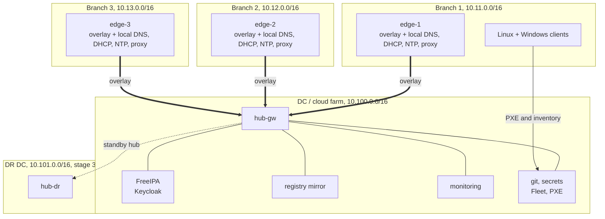

# ultus-corp: a reference corporate network lab

**Status:** draft for approval, 2026-11-26, revised 2026-11-27
**Scope:** a three-branch company with a primary data centre, a disaster-recovery
data centre and a hub, built from CentOS Stream 10 bootc images and run as
libvirt VMs. It starts with one service and its zone, then adds the directory,
the IdP, endpoint management and the stateful roles a corporate network actually
needs. Every component is designed and tested as its own bounded scenario, and
the full topology is never resident.
**Relationship:** independent of `infra-overhaul`. It may later supply images,
patterns and evidence to that project. It inherits no client data, addresses,
secrets or vendor contracts.

## Intent

This is a personal reference design: a lab that is free to be wrong, cheap to
rebuild from nothing, and realistic enough that its failures teach something
about a real corporate network. It answers a question the client estate cannot
answer safely: what does a fresh corporate network look like when every server
is an image and every role is code?

It is a modular, containerised reference network. Every host is a bootable
container image, and every service inside it is either a container or a
packaged daemon. That is what makes the network modular: a role is replaced by
changing an image reference, not by logging in and editing files.

## Audience

Written for a DevOps engineer coming from a Windows background who is
strengthening Linux system design. Two consequences run through the whole
document.

- Every role names the Linux mechanism it depends on, and the Windows
  equivalent the reader already knows, where one exists. DNS as a service is
  the same idea. `systemd` units, SELinux labels, `nftables` and `bootc` are
  not, and each gets a one-line bridge to its Windows counterpart.

- The lab is judged on whether it teaches the mechanism, not on whether it
  runs. A green test that hides why it passed is a failure here.

The shape is a central control plane and a local data plane. The primary data
centre owns identity, policy, configuration, endpoint management and the
artifact registry. Each branch runs its own DNS, DHCP, NTP and proxy so the LAN
survives a WAN loss. The DR data centre runs the same role images as a standby
hub, so losing the primary data centre costs the branches their central services
but not their local ones. A WireGuard overlay is only the transport between
them, and a new branch is one spec entry and one address block, never a code
change.

The design is complete. The lab is not. Every component below is also a
scenario: a bounded set of VMs, a spec entry, a test and a measured footprint.
The host runs one scenario at a time and tears it down, so the whole design is
covered without ever running the whole topology. Whole-topology runs are rare
assembly checks with a dated evidence file, not the normal mode.

## Goals

- One tree, one image per role, each built, scanned, signed and booted from the
  pipeline.
- One scenario per component, each one booted, tested and torn down in
  isolation, with its footprint measured and recorded.
- Components that carry to a real rebuild: image, config template and test
  travel; the trust root, names and keys are reissued.
- Three branches plus a primary and a DR data centre, connected hub-and-spoke,
  that exercises DHCP relay, split-horizon DNS, cross-branch routing and an
  active/active pair.
- A branch that keeps resolving, leasing and telling time when its overlay link
  is cut.
- A real identity stack: FreeIPA as the source of truth, Keycloak federated to
  it, FreeRADIUS using FreeIPA-issued certificates.
- Endpoint onboarding end to end: PXE to an installer, certificate trust,
  802.1X and app SSO, driven from one management plane.
- Every scenario rebuildable from the repository, from an empty host.
- Generated artifacts have a budget: role images, builder output and base disks
  share 20 GiB. `lab prune` reclaims them and refuses to remove a file a running
  domain has open.
- Fully isolated: its own address plan and trust root, no route into the real
  estate or the personal tailnet.
- Publishable: no client name, no real address, no secret, no exported zone.

## Non-goals

- A resident full topology. The diagram is the target. The lab reaches it in
  scenarios and occasional assembly runs.
- Production availability. There is no shared storage, no cluster SLA and no
  on-call obligation.
- A full device fleet. One runnable client per OS is the ceiling the isolation
  allows; macOS is documented, because it cannot be virtualised on this host.
- Running Entra or Intune. They cannot run in an isolated lab; their shape is
  mapped to Keycloak and Fleet.
- Windows Autopilot. It needs Entra and the internet. PXE to WinPE is the lab
  path.
- A real cloud VPC. The cloud farm is a fourth site on the same hypervisor, and
  the hub role is written so it can move later.
- Performance benchmarking. VM sizing is enough to run the roles, not to
  measure them.
- Migrating anything from the Windows estate. This is greenfield.

## Anti-goals

A change counts as a failure, even if it works, when it:

- puts a secret, a private key or an exported zone in git;
- puts a private key or a shared secret inside an image;
- commits a Microsoft or Apple installation image;
- hand-configures a VM that is not described by the checked-in spec;
- leaves a service that cannot be rebuilt from the repository;
- routes the lab into the real estate or the personal tailnet;
- issues a service certificate from a public CA;
- reuses the lab address plan on a real network;
- lets a component become permanent without a decision to keep it.

## Constraints

- The lab host is this workstation, chosen 2026-11-26. Measured: 12 threads,
  30 GiB RAM, 56 GiB free disk, one 1 GbE NIC and one idle Wi-Fi NIC. libvirt,
  `virt-install` and `cloud-localds` are not installed yet.
- Zero cloud spend. Every scenario runs on hardware on hand, so no scenario may
  depend on a rented host or a SaaS trial.
- The host is shared with daily work. A scenario may not need the desktop
  stopped. Only an assembly run may.
- The base is CentOS Stream 10 image mode, built with bootc. No Fedora, Ubuntu
  or Debian guest.
- The lab guests have no internet by default. The build host and CI do. The DC
  hub is the only runtime egress, and it is a toggle.
- macOS cannot be virtualised on non-Apple hardware. It is documented, not built
  or booted here.
- Workstation MDM is out of scope. No Apple device enrolment, no Windows
  Autopilot, and no APNs or Entra dependency. Fleet provides inventory and
  policy only.
- Windows and macOS installation media are downloaded by the operator and
  never committed.
- Every credential is generated once and kept outside the repository.
- The repository is public, MIT licensed, and generic.

## Scenario model

A scenario is the unit of work: an id, the spec entries it needs, its declared
dependencies, its test, its peak footprint and its teardown. `lab up s3-overlay`
runs one scenario. `lab down s3-overlay` returns the host to where it started.

Rules that make the model hold:

1. A scenario declares only the dependencies it needs, never everything for
   safety.
2. A single scenario uses fewer than five VMs and at most 10 GiB of RAM. The
   assembly runs are exempt and are listed separately.
3. `up` and `down` are symmetric. `down` leaves no domain, network, volume or
   generated key, and a second `up` succeeds.
4. A scenario rebuilds from an empty host in under ten minutes once its role
   images exist in the registry mirror.
5. Each scenario declares the interfaces it exposes and consumes: ports, DNS
   names and certificate purposes. A static check confirms the declarations
   compose.

| Scenario | VMs | RAM | Proves |
| --- | --- | --- | --- |
| s0-base | 1 | 2 GiB | an image builds, boots, upgrades and rolls back |
| s1-dns | 2 | 3 GiB | authoritative plus recursive, delegation intact |
| s2-dhcp | 3 | 3 GiB | relay plus Kea, a lease survives a restart |
| s3-overlay | 4 | 8 GiB | hub and one branch edge, routes, nftables policy, the branch services, and the uplink-down case |
| s4-pki | 2 | 3 GiB | root to intermediate to ACME leaf, trust without copying |
| s5-identity | 4 | 9 GiB | FreeIPA, Keycloak federation, one OIDC app |
| s6-radius | 3 | 5 GiB | FreeRADIUS, a real authenticator, EAP-TLS from a real supplicant |
| s7-delivery | 3 | 6 GiB | registry mirror, egress toggle, pull through the hub |
| s8-observe | 2 | 5 GiB | metrics, logs and a secret rotation without a rebuild |
| s9-endpoints | 3 | 10 GiB | PXE to an installer, Fleet enrolment, Windows certificate trust |
| s10-stateful | 4 | 10 GiB | print across a node loss, file, IPAM, backup and restore |

| Assembly run | VMs | RAM | Proves |
| --- | --- | --- | --- |
| assembly-min | 8 | 12 GiB | hub, branch 1, identity and one client, at the same time |
| assembly-branches | 11 | 16 GiB | add-a-branch and branch survival, across two branches |
| full | 23 | 30 GiB | the whole diagram, documented and never run on this host |

Each branch is one edge VM that also serves its local DNS, DHCP, NTP and proxy.
The counts reflect that. RAM is re-measured when s3 lands, because the edge now
carries the service memory.

Peak for any single scenario is 10 GiB. The host has about 18 GiB free with the
desktop running, so every scenario fits as normal work. Both assembly runs need
the desktop stopped. The full three-branch diagram needs the whole host and
still does not fit, and the design says so rather than scheduling a run that
cannot happen.

What the model costs: integration evidence is sampled, not continuous. Two
gates cover the gap. One is the static interface check. The other is the
assembly runs, which produce a dated evidence file. Neither pretends that a
green scenario proves the whole network.

## Approaches considered

### Overlay (chosen: hub-and-spoke, with a documented path to more)

| Approach | What you get | Why not |
| --- | --- | --- |
| **A. Hub-and-spoke** | Branches peer only with the DC hub. Three tunnels, one policy point, one key set per branch, and the branch config stays O(1) as branches are added. | Chosen. Branch-to-branch traffic hairpins through the DC. |
| B. Full mesh | Direct branch-to-branch paths. | Six tunnels at this size, more as branches grow, and every branch becomes a routing peer. |
| C. Hub now, direct paths later | Start hub-only, add policy-driven direct paths as their own evolution stage. | This is the evolution path, recorded below, not a separate build. |

### Identity (chosen: one authority, federated)

| Approach | What you get | Why not |
| --- | --- | --- |
| **A. FreeIPA source of truth, Keycloak federated** | One user store, Kerberos, CA, host policy; OIDC for apps; EAP-TLS for 802.1X. The AD plus Entra shape. | Chosen. Keycloak cannot create users, which is the realistic constraint. |
| B. Two authorities, switchable | Both native patterns side by side. | Two stores drift, and every service carries two configs. |
| C. Directory only | Smallest identity build. | Never exercises OIDC/SSO, which is most of a modern corporate network. |

### Endpoints (chosen: Fleet plus PXE, with the isolation ceiling)

| Approach | What you get | Why not |
| --- | --- | --- |
| **A. Fleet for inventory and policy, PXE for installs** | One management plane for Linux and Windows, osquery visibility, and onboarding from a blank VM. | Chosen. Fleet is inventory and policy, not MDM. Apple and Windows MDM are out of scope. |
| B. Client VMs only, no management plane | Cert trust, 802.1X and SSO tested per OS. | Onboarding is hand-run, which is the thing a corporate network never does. |
| C. A real Intune tenant | The production shape. | Needs Entra, the internet, and a licence, which breaks isolation and the public repo. |

### Platform (chosen: libvirt with a checked-in spec)

Proxmox needs a cluster the lab does not have. OpenTofu's libvirt provider is
rough enough that the provisioning surface would become the project. A TOML VM
spec plus a renderer is still IaC, and it rebuilds deterministically. TOML over
YAML because Python 3.11 and later read it with `tomllib` from the standard
library, so the renderer needs no dependency at all.

### Lab execution (chosen: one scenario at a time)

| Approach | What you get | Why not |
| --- | --- | --- |
| **A. One scenario per component** | The whole design is covered. Only one bounded component is resident, so it fits shared hardware and costs nothing. | Chosen. Integration is proven by a static check and a rare assembly run. |
| B. Resident topology, graded profiles | Continuous integration evidence, one `lab up` for the whole network. | Needs 18 to 41 GiB resident and a dedicated host. The host is also the daily driver. |
| C. Cloud lab per run | Unlimited size and full isolation per run. | A recurring bill, and the hardware on hand goes unused. |

## Decisions

| # | Decision | Choice | Why | Rejected |
| --- | --- | --- | --- | --- |
| D1 | Base | CentOS Stream 10 image mode, bootc, Podman Quadlet | EL parity, roughly five-year support, atomic upgrade and rollback | Fedora, which moves every six months; Ubuntu and Debian, which have no atomic rollback |
| D2 | Repository | Fresh tree, one `Containerfile.<role>` per role | The role pattern is proven in `dux-atomic`; the Fedora pin and desktop half are not | Forking `dux-atomic` |
| D3 | Topology | Three branches, a primary DC hub and a DR DC, hub-and-spoke WireGuard | Mirrors the estate the operator has run: a data centre with DR and branches hanging off it, and it is the smallest shape that shows central control with local survival | Two sites, which cannot show a flexible branch count; full mesh now |
| D4 | Platform | libvirt/KVM, TOML spec, `lab` renderer | Deterministic, cheap to rebuild, and parseable with the Python standard library | OpenTofu/libvirt first; Proxmox; a YAML spec with a parser dependency |
| D5 | Isolation | Dedicated libvirt networks, no forward to the host LAN, own address plan | Safe to publish and safe to break | Bridging to the home LAN; tailnet reachability |
| D6 | Identity | FreeIPA source of truth; Keycloak federates over LDAP; FreeRADIUS uses FreeIPA certs | One authority, AD plus Entra shape | Two stores; directory only |
| D7 | PKI | One offline lab root, two intermediates: step-ca for service TLS, FreeIPA CA for identity | Avoids a chicken-and-egg between TLS and identity, and shows a real hierarchy | One CA for everything; a public CA |
| D8 | DNS | BIND 9 primary in the DC; Unbound recursive per site; FreeIPA owns `ipa.lab.internal` | LAN resolution survives identity and the WAN being down | FreeIPA as the only DNS; dnsmasq |
| D9 | DHCP | Kea local to each branch, configured from the DC spec | Leases survive a WAN cut, and the branch stays a self-contained unit | DHCP relayed to the DC; DHCP on the directory |
| D10 | Edge | One bootc role with `branch` and `hub` profiles: FRR, nftables, WireGuard, DHCP relay. The `branch` profile also runs a BIND secondary, Unbound, Kea, chrony and a Caddy cache; the `hub` profile runs the hub BGP | The image thesis covers the network, not only the services | OPNsense appliances; host bridges only |
| D11 | Provisioning | `image-builder` qcow2 plus a NoCloud seed ISO | The maintained interface, with an explicit blueprint instead of an implicit config path | The legacy `bootc-image-builder` CLI; hand-built guests; cloud images |
| D12 | Secrets | Generated once into a gitignored `lab-secrets/`; root key offline | Nothing sensitive enters git or an image | Committed keys; secrets baked into images |
| D13 | Supply chain | cosign keyless per image, SBOM per image, trivy gate | Same gates as `dux-atomic` | Unsigned local builds |
| D14 | Lab unit | One scenario per component, run and torn down alone | The design is complete while the resident footprint is one bounded component, so it fits hardware on hand and costs nothing | A resident topology; graduated `--profile` sets |
| D15 | Licence and visibility | Public, MIT, generic | A reference design should be readable | Private; AGPL |
| D16 | Overlay growth | BGP over the tunnels is the first scaling step, then direct paths, then the DR hub | FRR already ships in the edge image, so growth is config, not a redesign | Hand-editing a full mesh |
| D17 | Endpoint management | Fleet for inventory and policy, PXE for Linux and WinPE. No workstation MDM | One inventory and onboarding plane, without an Apple or Entra dependency | Intune, which needs Entra; an MDM stack, which needs APNs or Autopilot; client VMs only, which leaves onboarding manual |
| D18 | 802.1X authenticator | `hostapd` with the wired driver on the users bridge | Gives real supplicants a real authenticator, not just `eapol_test` | `eapol_test` only, which proves the server and nothing else |
| D19 | Integration evidence | A static interface-composition check plus a dated assembly run | Composition is checked continuously where it can be, and sampled where it cannot | Assuming a green scenario proves the network |
| D20 | Rollback contract | The class belongs to each data store, not the role. Stateless roles redeploy the previous image; config-only roles redeploy the previous image and seed; durable stores are quiesced, backed up with the application's tool and restored into a matching image; rebuildable stores are wiped and re-created from the repository, a peer or upstream, with the accepted loss declared. A role can hold both, and `app` does. Gate 12 exercises one store per class, and gate 14 tests the declared loss | `/var` persists across deployments, and database schemas are not reliably reversible. Not all `/var` data is authoritative: DHCP leases, registry and proxy caches, monitoring history and deployment artifacts are rebuildable. Treating them as durable adds a backup burden that protects nothing | Treating `bootc rollback` as a data rollback; one generic snapshot rule for every role; backing up data that is cheaper to recreate |
| D21 | Update plane | Quadlet containers are declared as bootc logically bound images under `/usr/lib/bootc/bound-images.d`, pinned by digest, preloaded by the disk build, and read through `GlobalArgs=--storage-opt=additionalimagestore=/usr/lib/bootc/storage`. No unit sets `AutoUpdate=registry`, and the auto-update timer is masked. Changing an application means building a new host image | A floating container in `/var/lib/containers` is outside the image digest, rollback, offline boot and SBOM. Without the storage argument the unit still uses floating storage; without preloading, a cold boot with no egress has no image | Independent container auto-update; digest pinning that still allows in-place application updates |
| D22 | Branch footprint | One edge VM per branch. The branch profile runs the overlay plus a local BIND secondary, Unbound, Kea, chrony and a Caddy cache. Authority stays central; details reach the branch by zone transfer or at deploy. Unbound owns the client-facing `:53`, the BIND secondary binds a separate loopback address and port, and Unbound forwards the local zones to it | A branch needs local answers when the tunnel drops, and a second services VM buys nothing. Centralising the serving path would turn a WAN cut into an outage | A second services VM per branch; relaying DHCP and DNS to the hub |
| D23 | Delivery | Build once and promote the exact qualified digest. The repository records a per-role release manifest; the rollout agent selects the digest with `bootc switch`. The deploy path never rebuilds | A rebuilt deploy is a different artifact from the qualified one, and a mutable tag cannot say what a host runs | Rebuilding at deploy; deploying a tag |
| D24 | Pipelines | Two. A qualifies a candidate on upstream digest drift, with the watcher and a qualification heartbeat as the only schedules, and neither deploys. B promotes and rolls out with a canary, waves, halts, parking and a maintenance window | Qualification and rollout fail differently, so they need separate triggers and rates. A daily upstream rebuild must not become a daily fleet reboot | One pipeline; scheduling the deploy |
| D25 | Update semantics | `bootc upgrade` and `bootc switch` update `/usr` and three-way merge `/etc`; `/var` persists. Per-site seed values stay deploy-time, and gate 15 checks the upgraded managed files against the candidate's expected manifest | An image-default `/etc` change can arrive with an upgrade, but a per-site value cannot be converged on a running host | Treating upgrade as `/usr` only; re-rendering `/etc` at runtime |
| D26 | Recovery | Recovery follows the store class. Only stateless stores take automatic `bootc rollback`. Durable stores park, page and restore a backup into the matching image; rebuildable stores re-create and run the gate-14 probe | A blind rollback on a durable store leaves newer data on an older binary, the failure D20 exists to prevent | One generic rollback for every class |
| D27 | Health and routing | The on-host probe has bounded timeouts, absence is failure, and each assertion is retryable or terminal. Failure order is recover, park, notify, and a threshold, timeout or recovery failure halts the waves | A green boot is not a working host, and silence is not success | Port-open checks; first-boot success |
| D28 | Dead-man and evidence | Two switches: no successful qualification in N days, and a silent watcher for 24 hours. Retain per-release evidence and a notification payload with a local reproducer | Every other alert fires on failure; these fire on silence, and later triage needs the release fields | Alerting only on failure; guest-only evidence |
| D29 | Prohibitions | Automation may not skip a gate, force-promote, rebase a channel, or delete the previous deployment. Break-glass is documented and logged | An unattended loop is only safe when the safe actions are the only ones available | Undocumented overrides |
| D30 | Update health gate | `greenboot` health checks in `/etc/greenboot/check/required.d`, one script per role. The check runs in the multi-user transaction and reads the durable deployment record: no record means an unprovisioned first boot is not judged, records mean the host is in service, and a delivered id with no record fails closed. Ordering the unit after `cloud-final` instead builds an ordering cycle, and systemd deletes the check | A failed upgrade reboots back to the previous image without a human at 03:00 | Trusting every promoted image; judging an unprovisioned first boot; a check ordered into a cycle |
| D31 | Host policy | `/etc/containers/policy.json` defaults to reject, with one signed exception for the lab registry | Signing in CI proves nothing unless the host refuses unsigned pulls | Signing without host policy |
| D32 | Role record | `docs/roles/<role>.md` with the Linux mechanism, the Windows analogy, where it breaks, and the proving command, gated in CI | The teaching claim becomes a checked artifact | Prose in the README |
| D33 | Rendered service configuration | The lab renderer emits the final `named.conf`, `unbound.conf` and zone into the seed, from spec records. The image ships none, and the guest only applies them | Rule 2 has one meaning: a guest never renders a `lab` template, and no run's address is baked into a build | A build-time placeholder that the guest rewrites at boot |
| D34 | DHCP relay mechanism | dnsmasq `--dhcp-relay` on the branch interface, Kea on the DC in s2, one `dhcp` role with `server` and `relay` profiles | s2 has no edge role yet, so the relay path is proven before s3 colocates Kea with the edge; the relay module is reused there | A second role per function; `dhcrelay`, which Stream 10 does not ship; relaying production DHCP to the DC, which D9 rejects |

## Configuration and deployment inputs

Configuration is a versioned artifact. The repository holds the templates, the
value schema, the non-secret values and the tests. The image holds what every
host of a role shares. The `lab` renderer turns `lab/lab.toml` into per-host
configuration at deployment. Nothing converges per-site configuration after
deployment. A bootc image rollout (§Delivery and maintenance) is the one
host-state change. It must not intentionally change per-site values, and gate 15
fails on an unexpected manifest difference.

| Layer | Owns | Home | Changes on |
| --- | --- | --- | --- |
| Source | templates, value schema, non-secret values, manifests, tests | this repository | a reviewed commit |
| Image | packages, `/usr`, static config, units, bound container digests | the image digest | a build |
| Deployment | identity and per-site service values, rendered | the NoCloud seed, written to `/etc` and `/var` | host creation or re-creation |
| Runtime | users, DNS records, realms, reservations | the service API | an operator decision |

Rules:

1. A change that would make two hosts from the same digest differ in `/usr`
   belongs in the image.
2. A per-instance value is declared in `lab/lab.toml` or `lab-secrets/`. The
   `lab` renderer turns it into a file at deployment. The guest never renders a
   `lab` template, and an operator never edits the file on the host.
3. The seed carries deployment inputs only: identity, the rendered per-role
   configuration, and the secret material a role needs at first boot. It carries
   no packages and no build steps.
4. Only the per-instance configuration runs once. `cloud-init`'s per-boot
   stages still run. The seed is mode 0600 and is never logged. When deployment
   ends, the `lab` CLI ejects the seed from the live and persistent domain
   definitions, deletes it, and marks it consumed so teardown tolerates its
   absence. Cached user-data is scrubbed. The gate asserts that one-time secrets
   are absent from the cloud-init cache and the logs, and that the seed file is
   gone.
5. A role that needs a first-boot install ships an idempotent, fail-closed
   oneshot unit, ordered before `ultus-role-install.target`. Every image ships
   that target. For a role with no installer it is an empty target, so ordering
   never depends on a unit that may not exist. The install may write `/etc` and
   `/var`, enable units, and render the vendor's own configuration from the
   supplied inputs. It never runs a `lab` template. Deployment ends when
   `cloud-init` and `ultus-role-install.target` both report success; before that
   the host is not in service.
6. The seed carries a `deployment_id` in `meta-data`. The renderer generates it
   as a lowercase UUIDv4 with hyphens and no other characters, so it is always a
   valid systemd instance name. `cloud-init` writes it to
   `/run/ultus-corp/deployment-id` and enables
   `ultus-deploy-finalize@<id>.service`. That template is ordered after
   `cloud-final.service` and `ultus-role-install.target`, and before
   `ultus-deploy-ready.target`, which pulls it in. Its condition is
   `ConditionPathExists=!/var/lib/ultus-corp/deployments/%i.json`, so it runs
   once per deployment id, not once per host. It writes that file with the id,
   the image digest, the role and the completion time, scrubs the cloud-init
   instance cache, and removes one-time secret material.
   `/var/lib/ultus-corp/deployments/` holds the current VM's record, not a
   history. When the host reaches ready, the `lab` CLI copies the record into
   its own state directory, keyed by deployment id, so rewrites happen at the
   harness level. `bootc status` is the only source for the running digest.
7. After deployment ends, nothing converges per-site configuration. Applications
   may write their own state under `/var`. Runtime automation may change API
   objects only, and a bootc image rollout follows §Delivery and maintenance.
8. A drifted host is re-rendered from the repository or replaced, not repaired.

## Rollback and upgrade

A role never rolls back by image alone when it holds data that cannot be
recreated. The class belongs to the data store, not the role, because one role
can hold a durable store and a rebuildable one.

| Class | Meaning | Rollback |
| --- | --- | --- |
| Stateless | no local data | `bootc rollback` to the previous image |
| Config-only | the seed is the only input, and there is no local store | previous image plus the previous seed |
| Rebuildable | data is re-created from the repository, a peer or upstream, and the accepted loss is declared | previous image plus the previous seed; wipe the store and re-create it |
| Durable | data cannot be re-created | quiesce writes, back up with the application's tool, restore into the matching image |

| Role | Class | Store, and how it comes back |
| --- | --- | --- |
| ntp, proxy | stateless | none |
| edge (hub), radius | config-only | none; every input is in the seed |
| edge (branch) | rebuildable | BIND secondary zone, Kea leases and the proxy cache; re-transfer, re-learn, re-fill |
| dns | rebuildable | the zone is rendered from `lab.toml`, where static records live; Kea and FreeIPA re-register dynamic records |
| dhcp | rebuildable | the lease store; clients re-DISCOVER |
| app | both | Keycloak realms rebuild from the repo; Gitea repositories are durable |
| registry | rebuildable | pull-through cache; it re-pulls |
| mon | rebuildable | metrics and logs; history is lost, and that loss is declared |
| fleet | rebuildable | Fleet enrolment re-establishes; policies are in the repo |
| deploy | rebuildable | artifacts re-sync from upstream |
| print | rebuildable | the spool is re-queued; printer configuration is rendered |
| ipam | rebuildable | NetBox projects the address plan in `lab.toml` for consumers; objects typed into NetBox are not durable |
| pki | durable | CA keys and issued material |
| ipa | durable | directory and Kerberos keys |
| secrets | durable | OpenBao storage and unseal material |
| file | durable | Samba share contents |

For a rebuildable store the repository, a peer or upstream is the source of
truth. An API object that matters is promoted into the repository, or it is not
durable. A durable store is never silently recreated, and a rebuildable store is
never backed up.

A redeployment is a new VM. It starts from the image and a fresh seed, and only
durable stores are restored. Every rebuildable store is re-created, and its loss
is the list declared for it.

The `lab` state directory owns deployment history, not the guest. The guest keeps
one record for the current id. A redeploy adds a new record at the harness, and
the old one stays there. Deployment history is not a durable store, so it is
never restored into a new VM.

Each rebuildable store declares a probe and its expected state after a rebuild.
Gate 14 runs the probe; a store with no probe fails the gate.

| Store | Probe | Expected after rebuild |
| --- | --- | --- |
| dns | `dig` a static and a dynamic record | static answers from the seed; dynamic records re-register |
| edge (branch) | `dig` a zone record, lease a client, fetch a cached object | the zone re-transfers; a new lease; the cache re-fills |
| dhcp | a client acquires a lease | a new lease; old leases absent |
| app / Keycloak | OIDC login to a realm declared in the repo | login succeeds; ad-hoc realms absent |
| registry | pull a pinned image through the mirror | pull succeeds; the cache refills |
| mon | query a metric and a log from before the rebuild | empty; collection resumes |
| fleet | query the enrolled host | it re-enrols on the next check-in; old inventory absent |
| deploy | PXE boot a client | artifacts re-sync; old TFTP state absent |
| print | submit a job | it queues; the old spool is absent |
| ipam | query an object declared in `lab.toml` | present; typed objects absent |

s0 builds the DNS store from the seed on a fresh host. It proves the image
rollback path, not a wipe of an existing store and not a durable restore.

A bootc-only rollback starts no new seed and runs no finalize. The deployment log
keeps the last completed id, and `bootc status` reports the rolled-back digest.
A redeploy with a new seed is a new id and adds a record. The two cases are never
conflated.

## Delivery and maintenance

This is the operations model a real rebuild inherits. The lab proves gate 15 and
the per-role probes; it does not run a resident fleet (§Scenario model, D14). The
goal is exception-based operations: builds, qualification, promotion, rollout and
recovery run unattended, and a human is engaged only when the automation says it
cannot proceed safely.

### Build and promotion

- Build once. A change produces one candidate image per affected role, pinned by
  base digest and the resolved NEVRA lock (gate 13). That candidate digest is the
  only artifact that can be promoted.
- Promote the exact digest. Promotion writes the qualified digest into the
  per-role release manifest with an idempotent, reviewed commit. Rollout and a
  fresh deployment consume that manifest, and the rollout agent selects the digest
  with `bootc switch <repo>@sha256:<digest>`. The deploy path never rebuilds.
- The repository is the source of desired state. The registry is the source of
  artifact identity. Tags are mutable, and GHCR has no documented tag-immutability
  control, so digest pinning is the enforcement.

### Pipeline A: qualify

Triggered by upstream drift. A scheduled qualification heartbeat runs without
drift so the dead-man's switch has a signal; it never deploys. The watcher is the
only other scheduled part.

1. The watcher compares the upstream base image digest with the digest recorded
   from the last build. It dedupes, so one upstream rebuild produces one change.
2. The change is a reviewable one-line bump of the pinned base digest.
3. Build with the pinned base and the NEVRA lock. No unpinned `dnf install`.
4. Blocking gates: `bootc container lint`, a vulnerability scan with an explicit
   severity threshold, SBOM generation, image signing, and provenance annotations
   for the source commit, base digest and lockfile hash.
5. Qualification fresh-boots the candidate, then boots the previous release and
   switches it to the candidate. Both legs assert zero failed units and the
   workload smoke set; the upgrade leg is gate 15.
6. Publish the qualified digest with its evidence. A failure produces a ticket or
   a change-request comment, not a page, because nothing reached a host.

### Pipeline B: promote and roll out

1. Promotion writes the qualified digest into the per-role release manifest with
   an idempotent, reviewed commit, then copies the artifact to the release
   reference. It rebuilds nothing.
2. Canary: one host upgrades, reboots, and passes the health probe.
3. Waves with a concurrency cap and a health gate between them.
4. Halt on the failure threshold, a probe timeout, or a recovery failure. A halt
   parks the digest.
5. A parked digest is not retried automatically. The next attempt needs a new
   build.
6. Promotion is rate-limited separately from qualification and batched into the
   maintenance window. A daily upstream rebuild does not become a daily fleet
   reboot.

### Update semantics

`bootc upgrade` and `bootc switch` update `/usr` and three-way merge `/etc`: the
new image's default `/etc` is the base, the current-versus-previous diff is
applied, and a locally modified file that differs from `/usr/etc` is retained.
`/var` persists. An image-default change to `/etc` can therefore arrive with an
upgrade, while a per-site seed value remains deploy-time and needs a new VM. Gate
15 compares the upgraded host's managed files against the candidate's expected
manifest, not the previous release's baseline, and fails on an unexpected
difference.

### Recovery per class

A probe failure does not trigger one generic rollback. The action follows the
store class in §Rollback and upgrade.

| Class | Automatic action on failure |
| --- | --- |
| Stateless | `bootc rollback` to the previous image. This is the only class where blind automatic rollback is safe |
| Config-only | previous image plus the previous seed, redeployed |
| Rebuildable | previous image plus the previous seed, wipe the store, re-create it, run the gate-14 probe, and declare the loss |
| Durable | park, page, and restore the application-consistent backup into the matching image. Never blind `bootc rollback` |

A durable-store canary passes normally. On failure it parks and pages; it does not
roll the image back and leave newer data on an older binary.

### Health probe contract

The probe runs on the host after reboot and reports within a bounded timeout. Each
assertion has its own timeout:

- the system is running with zero failed units;
- every managed service is active, not activating;
- identity works: membership is listed and a test identity resolves;
- the workload answers, not merely that a port is open;
- certificates and keytabs are present, readable and unexpired;
- the host is on the expected digest, read from `bootc status`.

Absence of a report is failure. A soak window is sized per role, so success is not
reported at first boot. Each assertion is retryable or terminal: a
network-dependent identity check may retry, and a failed unit is terminal.

### Failure routing

| Class | Automatic action | Notification |
| --- | --- | --- |
| Build, lint or scan gate | stop before publish | ticket or comment, no page |
| Canary or wave probe failure | recover by class, park the digest, halt the waves | page once recovery is confirmed |
| Recovery failure | halt everything, preserve host state | page, highest urgency |
| Host off the expected digest | report only | daily digest |
| Watcher or pipeline stopped running | none available | page after a threshold |

The order is recover, then park, then notify. A parked digest is never retried
automatically.

### Dead-man's switches

- Alert when no successful qualification run has completed in N days. A scheduled
  qualification heartbeat satisfies the switch during a healthy idle period, and
  it never triggers a deploy.
- Alert when the watcher has not reported in 24 hours.
- Distinguish "no update available" from "registry unreachable". The lab's guests
  deny egress by default, so an unreachable registry is the normal guest state and
  must not read as a missing update.

The qualification controller owns the first switch and the rollout controller owns
the second.

### Evidence and notifications

Per release, retain: source commit, base digest, lockfile hash, SBOM reference,
scan result, qualification run id, promoted digest, wave timings, and the digest
each host reports after upgrade. Gate 11 already records the deployment id,
digest, role and time; the release fields extend it.

Every page carries the failing digest, host, gate, verbatim probe output, last
known-good digest, a run link, and one command that reproduces the failure
locally. Each gate has a runbook with that reproducer and a role as owner, not a
person.

### Prohibitions and break-glass

Automation may not skip a gate, force-promote, rebase a host to another channel,
or delete the previous deployment. Break-glass is a documented, logged action, not
a silent override.

## Target architecture



## Addressing and naming

| Site | Prefix | Segments |
| --- | --- | --- |
| DC | 10.100.0.0/16 | mgmt .10, srv .20, dmz .30 |
| DR DC | 10.101.0.0/16 | mgmt .10, srv .20, dmz .30 |
| Branch 1 | 10.11.0.0/16 | mgmt .10, usr .20, prt .30, guest .40, srv .50 |
| Branch 2 | 10.12.0.0/16 | mgmt .10, usr .20, prt .30, guest .40, srv .50 |
| Branch 3 | 10.13.0.0/16 | mgmt .10, usr .20, prt .30, guest .40, srv .50 |
| Branch proof (s2) | 10.200.0.0/16 | lan .10 |

The `Branch proof (s2)` block is the s2 proof site, not the design's Branch 1 at
`10.11.0.0/16`: the branch edge does not exist yet, so s2 proves the relay
without one.

- Overlay: `10.255.0.0/16`. Hub `.0.1`, branch *n* `.n.1`.
- AS 65000 at the hub, 65001 to 65003 at the branches.
- Realm `LAB.INTERNAL`. Zone `lab.internal`, delegated `ipa.lab.internal`.
- Hostnames carry the site: `dns-br1.lab.internal`, `hub-dc.lab.internal`.
- The overlay space is separate from every site prefix, so a leaked route is
  obvious.

The DR DC runs the DC column from the same role images, in standby. It is not a
second code path: the only difference is which hub on the overlay is active, and
that is spec and key state, not an image. Evolution stage 3 makes it live. It is
excluded from the `full` count, which covers the primary data centre and the
three branches.

## Service placement

| Service | DC | Branch | Why |
| --- | --- | --- | --- |
| FreeIPA, Keycloak | yes | no | one authority |
| step-ca | yes | no | one service root |
| Fleet, PXE | yes | relay only | one onboarding plane |
| Authoritative DNS | primary | no | central source of truth |
| Recursive DNS | yes | edge | resolution survives a WAN cut; zones transfer from the hub |
| DHCP | no | edge | leases survive a WAN cut; scopes render per branch |
| NTP | yes | edge | local clock; the hub is the upstream |
| Proxy cache | yes | edge | local TLS termination; config renders per branch |
| Registry mirror | yes | pull only | the hub is the only egress |
| Monitoring, git, secrets | yes | agent only | central |
| Print, file, IPAM | yes | no | central, and stateful |

"Branch" means the edge VM. It is the only branch server: the overlay, the
firewall and the local services share one bootc image and one deployment.

### How details reach a branch

| Detail | Source of truth | Path to the branch |
| --- | --- | --- |
| `lab.internal` zones | hub BIND primary | AXFR/IXFR to the branch secondary over the overlay |
| DHCP scopes and reservations | `lab.toml` | rendered into the branch seed at deploy |
| Proxy cache policy | `lab.toml` | rendered into the branch seed at deploy |
| Time | hub chrony | upstream over the overlay |
| Identity | FreeIPA in the DC | forwarded while the tunnel is up; identity does not survive a cut |

Nothing pushes host configuration at runtime. A reservation change is a branch
redeploy with a new seed. DNS is the exception because zone transfer is the
protocol's own replication, not a configuration channel.

### DNS listener contract

Two resolvers on one host need two addresses. No daemon binds an address and
port another already holds.

| Host | Binds | Serves |
| --- | --- | --- |
| hub primary | its service address on `:53` | `lab.internal` authoritative |
| hub resolver | loopback and management addresses on `:53`, never the primary's address | recursion; forwards `lab.internal` to the primary |
| branch edge | the client-facing address on `:53` (Unbound) | recursion for clients; forwards `lab.internal` |
| branch edge | `127.0.0.53:5353` (BIND secondary) | the transferred `lab.internal`; the forward target for Unbound |

A branch client is configured with the edge address only. `ipa.lab.internal` is a
delegation to FreeIPA: it answers while the tunnel is up, and fails after its TTL
expires during a cut. That failure is the declared identity behaviour, not a
fault. External names also fail during a cut; only the local zones are
guaranteed, because that is all the secondary holds.

A node that runs both roles takes its service address for BIND and loopback for
Unbound, which is one address each. The management binding is for a hub where the
primary is a different host, so the table never asks one address to carry two
daemons.

## Endpoint coverage

| Capability | Linux | Windows | macOS |
| --- | --- | --- | --- |
| PXE install | iPXE and kickstart | iPXE, wimboot and WinPE | none, documented |
| Directory | FreeIPA client | none, local account plus OIDC | none, local account plus OIDC |
| Management | Fleet agent | Fleet agent, manual enrolment to verify | out of scope; no MDM |
| Certificate trust | `update-ca-trust` | script or profile | `.mobileconfig` |
| 802.1X | wpa_supplicant | native supplicant | native profile |
| App SSO | OIDC | OIDC | OIDC |

macOS is documentation only. It cannot run on this host, so the macOS column
records what a real Mac would need, not what this lab proves. Workstation MDM is
out of scope, so no configuration profile is generated or validated.

## Roles and images

| Debuts in | Role | Image | Stateful? |
| --- | --- | --- | --- |
| s0 | dns | BIND 9 primary, Unbound at the DC | zone data at the primary |
| s2 | dhcp | Kea server and a dnsmasq relay, lease store | yes |
| s2 | client | DHCP client, NetworkManager, no added package | no |
| s3 | edge | FRR, nftables, WireGuard, DHCP relay, `hostapd`; `branch` profile adds a BIND secondary on `127.0.0.53:5353`, Unbound on the client-facing `:53`, Kea, chrony and a Caddy cache, and the `dhcp` role's relay module; `hub` profile adds the hub BGP | config only at the hub; rebuildable at the branch |
| s3 | ntp | chrony | no |
| s4 | pki | step-ca | yes, small |
| s4 | proxy | Caddy, certmonger client | no |
| s5 | ipa | FreeIPA server and replicas | yes |
| s5 | app | Quadlet: Keycloak, Gitea | yes |
| s6 | radius | FreeRADIUS, EAP-TLS | config only |
| s7 | registry | pull-through cache and mirror | yes |
| s8 | mon | Prometheus, Loki, Grafana | yes |
| s8 | secrets | OpenBao | yes |
| s9 | fleet | Fleet, MySQL | yes |
| s9 | deploy | iPXE, TFTP, HTTP, WinPE | yes, small |
| s10 | print | CUPS | yes |
| s10 | file | Samba | yes |
| s10 | ipam | NetBox | yes |

A role debuts in the scenario that first needs it, and later scenarios reuse the
same image. The image is the unit of build and test. The scenario is the unit of
run.

Every image is built in two layers. `Containerfile.core` is `FROM` the pinned
`quay.io/centos-bootc/centos-bootc:stream10` digest, installs
`manifests/packages-common.txt` with its lock, and copies `modules/base/` onto
`/`. That is `localhost/ultus-corp/core`, and it is the only image that names
the upstream base.

Each role image is `FROM` that core by digest, installs only its own manifest
and lock, and copies `modules/<role>/` onto `/`. A role's build-time steps live
under `/usr/libexec/ultus-corp/build.d/`, run in name order, and assert their own
enablement. `manifests/core.txt` records the qualified core as
`<repository>:<tag>@sha256:<digest>`, and it is an artifact of the core build,
never a hand-edited pin. The static gate holds `Containerfile.core` to the pinned
base and every role to the core digest, so a role that names the upstream base
fails before it builds.

The split keeps the shared layer in one place. A common package change rebuilds
the core and every role, and a role change rebuilds one role. A common package
is declared once, in the core manifest, so two roles cannot drift to different
versions of it.

## Scenarios and exit criteria

| Scenario | Work | Exit |
| --- | --- | --- |
| s0-base | Repo skeleton, CI, one `dns` role, one VM | A lookup answers, then `lab down s0-base` leaves no domain, network or volume |
| s1-dns | Authoritative plus recursive, delegation to the FreeIPA stub | A client resolves `dns-br1.lab.internal` and `ipa.lab.internal` through the pair |
| s2-dhcp | Relay on the branch, Kea in the DC for s2, edge-local from s3 | A client leases across the relay, and the lease survives a Kea restart, a relay restart and a client reboot |
| s3-overlay | Hub and one branch edge, WireGuard, nftables policy, hub-and-spoke routes, and the branch services | Before the cut, the branch secondary completes an AXFR of `lab.internal` and the proxy cache serves one object. Branch 1 then reaches DC subnets and cannot reach branch 2; with the uplink down, the edge answers DNS from the transferred zone, leases a new client, serves time and serves the cached object, and `ipa.lab.internal` fails cleanly after its TTL |
| s4-pki | Offline root, step-ca intermediate, ACME issuance | A guest receives a leaf from step-ca and trusts it without a manual copy |
| s5-identity | FreeIPA, Keycloak federation, one OIDC app | A FreeIPA user logs in to Gitea over OIDC, and no local account exists |
| s6-radius | FreeRADIUS, `hostapd` wired authenticator, a Linux supplicant | `eapol_test` passes, then a real supplicant completes EAP-TLS |
| s7-delivery | Registry mirror, egress toggle, pull-through | A guest pulls an image through the hub with egress off, and egress on only for updates |
| s8-observe | Prometheus, Loki, Grafana, OpenBao | Every role in the scenario emits metrics and logs, and a secret rotates without a rebuild |
| s9-endpoints | Fleet, PXE, WinPE, a Windows client | A blank VM PXE-boots to an installer, Fleet shows the client, and Windows trusts the root and completes EAP-TLS |
| s10-stateful | Print, file, IPAM | Print survives a node loss, IPAM serves the address plan from the repository, and a Samba share restores from backup |
| assembly-min | Every role that the minimum topology needs, at once | Hub, branch 1, identity and one client work together, and an OIDC login crosses all of them |
| assembly-branches | Branches 2 and 3 added as spec entries | Adding branch 3 is one spec entry and one address block, and cutting a branch overlay leaves it resolving, leasing and telling time |

## Evolution

The lab starts hub-and-spoke and is written so each later step is a config
change, not a redesign. FRR already ships in the edge image, so BGP over the
tunnels is the first move that scales.

| Stage | Change | Trigger | Cost |
| --- | --- | --- | --- |
| 0 | Hub-and-spoke, static WireGuard `AllowedIPs` | now | one peer per branch on the hub |
| 1 | BGP over the tunnels, hub as route reflector | a second branch, or any change that touches every node | edge config only |
| 2 | Direct spoke-to-spoke for selected pairs | a branch-to-branch workload that cannot take the hairpin | one extra peer and a more specific route |
| 3 | The DR DC becomes a live hub, BGP multipath | DR is a stated requirement, so a hub loss must not take the branches offline | two hub profiles, every branch peers with both |
| 4 | Local internet breakout at large branches | SaaS latency or DC egress cost | policy routing per prefix, the hub stops being the only egress |
| 5 | A control plane for keys and routes (Headscale, NetBird) | more branches than hand-managed keys carry, or short-lived keys required | overlay identity tied to FreeIPA |

The scaling constraint is WireGuard itself: `AllowedIPs` is the routing table.
In hub-and-spoke a branch needs one peer entry, so the branch config is O(1),
but the hub is O(N). BGP moves the per-branch route into the protocol. That is
the step that turns "a flexible number of branches" from a claim into a
property.

## Reuse in a real rebuild

The point of one scenario per component is that each one becomes a part you can
carry to a real rebuild. That holds for the mechanism, not for the parameters.
The split is deliberate and worth stating before someone copies the wrong half.

| Transfers unchanged | Why it survives the move |
| --- | --- |
| Role images and their build chain | Same base, same package manifest, same `build.d` assertions. A real estate needs a repin, not a rewrite. |
| Config templates per role | BIND zones, Kea scopes, FRR and nftables policy, WireGuard peer shape. Only the values change. |
| Scenario tests | Each one is an acceptance test for one component. That suite is the thing that makes a rebuild safe rather than hopeful. |
| Interface declarations | What a role consumes and exposes. This is the seam where a component meets the rest of the network. |
| Renderer and spec format | One TOML entry per node. Scale is a data change. |

| Must be reissued, never carried | Why |
| --- | --- |
| Trust root | A root that touches both lab and production makes a lab compromise a production compromise. Build a new hierarchy. |
| Realm and zone names | `LAB.INTERNAL` and `lab.internal` are placeholders. Real names come from the estate and its DNS ownership. |
| Address plan | The lab blocks are public placeholders. Reusing them on a real network is an anti-goal. |
| Every key and shared secret | Generated per host. A carried key is a shared key. |
| Accounts and enrolments | Hosts and users enrol into the new authority. Nothing is migrated from the lab. |

| Not proven here | What a real rebuild still owes |
| --- | --- |
| High availability | Every role is a single instance. A critical role needs a pair, and pair behaviour is untested. |
| Vendor switch and AP layer | 802.1X on real ports, DHCP snooping, relay on the access switch. The lab proves the server side only. |
| Server install medium | A real rebuild needs a bootc install medium for bare metal, either a `bootc-image-builder` ISO or `bootc install to-filesystem`. The lab proves the qcow2 path only. |
| Scale | Four VMs show the shape. They do not find the limit at forty branches. |
| Fleet rollout | The lab proves gate 15 and the per-role probes, not the canary, wave, parking or dead-man controllers in §Delivery and maintenance. |

So the repo is a reference implementation and an acceptance suite, not a
deployable bundle. A real rebuild is the same components with new parameters,
plus the HA and vendor layers the lab does not prove. The parameters are the
seam: site prefixes, realm, trust root and per-host keys live in `lab.toml` and
in `lab-secrets/`, so re-pointing the lab at a real estate is a data change with
a deliberate, visible set of new secrets.

## Repository layout

```
Containerfile.core                the shared layer, FROM the pinned base
Containerfile.<role>              one per role, FROM the core digest
manifests/base.txt                the pinned upstream base
manifests/core.txt                the qualified core, written by its build
manifests/packages-common.txt     shared set, owned by the core
manifests/packages-<role>.txt     role additions
manifests/*.lock                  generated third-party pins
build/                          common.sh, manifest.sh, package-lock.sh
modules/base/                   the shared files, copied into the core
modules/<role>/                 role files copied onto /
overlay/                        files every role gets
lab/                            lab.toml, renderer, scenarios, seeds
release/                        per-role release manifest
endpoints/                      kickstart and WinPE answer files
tests/                          static gate, image gate, VM harness
docs/                           design, plans, runbooks
.github/workflows/              ci.yml (qualify), promote.yml, repin-base.yml (watcher)
```

## Gates

1. Static: base pin by tag and digest, one package per manifest line, no secret
   pattern in the tree, `Containerfile.core` `FROM` the pinned base, every role
   `FROM` the core digest, no installation media committed.
2. Build: the core builds once, then each role image builds in a CI matrix from
   that exact core digest.
3. Image: `bootc container lint`, role units enabled, the core lock matches the
   core image and each role lock matches what the role adds.
4. Scenario: `lab up <scenario>` boots it and its own test passes, with each
   assertion recording the command, the expected value and the observed value in
   `run/evidence/<scenario>.log`. A green line without an observation is not
   evidence.
5. Teardown: `lab down <scenario>` leaves no domain, network, volume or
   generated key, and a second `up` of the same scenario succeeds. A cleanup
   that cannot finish keeps its state file and fails loudly for human review.
6. Interface: every cross-scenario dependency is declared, and the static check
   confirms the declarations compose.
7. Assembly: the add-a-branch and branch-survival tests, run as
   `assembly-branches` and recorded with a date.
8. Supply chain: trivy, SBOM, cosign keyless.
9. Isolation: a test asserts every rendered network is `isolated`, has no DHCP
   and no libvirt DNS, that lab ranges do not overlap the host's uplink, and
   that a deliberately leaking fixture fails the same check. It runs on rendered
   definitions before boot.
10. Managed files: the expected checksum manifest is produced on the lab side
    from the exact bytes the seed carries, at
    `run/<scenario>/render/<node>.managed-files.sha256`. For the `dns` role it
    covers `/etc/named.conf` and `/etc/unbound/unbound.conf` on every node, and
    `/var/named/lab.internal.zone` on a primary only. The secondary's transferred
    zone, either node's journal files and the cloud-init cache are excluded,
    because they are runtime state. The gate compares the manifest after
    readiness and after a second boot, and requires that hand-editing one
    managed file on the primary fails the same comparison.
11. Deployment: the guest holds exactly one record for the current deployment id
    under `/var/lib/ultus-corp/deployments/`, with the expected image digest and
    role. It is unchanged after a second boot, and the finalize unit does not
    start again for that id. The `lab` state holds one record per id, so a
    redeploy adds one and leaves the old one. The seed is ejected and deleted,
    and the cached user-data is scrubbed.
12. Rollback: one store from each class in `§Rollback and upgrade` is exercised.
    A stateless store returns to the previous image, a config-only store to the
    previous image and seed, a rebuildable store is wiped and re-created, and a
    durable store restores from its backup into the matching image. The gate is
    not satisfied until every class has run.
13. Reproducibility: the build consumes a lock of resolved NEVRA versions, and a
    package transaction outside the lock fails the build.
14. Rebuild: on one selected host, each rebuildable store runs the probe in
    `§Rollback and upgrade` and meets its expected state. The gate verifies
    every durable backup on that host restores first, destroys the host's
    `/var`, re-runs deployment, and asserts the declared loss. A store with no
    probe fails the gate, and stores on other hosts are out of scope.
15. Upgrade qualification: two legs. The candidate fresh-boots with zero failed
    units and passes the workload smoke set. Then the previous release boots,
    switches to the candidate, and passes the same checks with its managed files
    compared against the candidate's expected manifest. On a role's first release
    the previous-release leg is recorded as not applicable. The same gate pushes
    an unsigned image and asserts the host policy refuses it.
16. Role record: every role image has a `docs/roles/<role>.md` with all four
    fields, and the proving command in it exits zero in the role image.

## Secrets and trust

- One offline root CA, generated once by a script, kept in `lab-secrets/`
  outside git. Two intermediates: step-ca for service TLS, FreeIPA CA for
  identity.
- Service TLS is issued over ACME from step-ca. Identity certs come from
  FreeIPA, which also issues the 802.1X client and server certs.
- RADIUS shared secrets, Keycloak's bind password, OpenBao unseal material and
  WireGuard private keys are generated per host and injected at first boot from
  a seed or a secret store, never baked.
- Public keys, trust anchors, peer addresses and policy are safe in the image.

## Settled by the builder

The builder check raised ten questions. All now have a call.

| Question | Call |
| --- | --- |
| Build connectivity | The build host and CI have internet; the lab guests do not. CI is GitHub Actions with keyless OIDC, as in `dux-atomic`. |
| Image signing and SBOM | GitHub Actions keyless OIDC, one signature and one SBOM per role image. |
| Artifact distribution | Images to GHCR by digest. The DC runs a pull-through mirror; the host builds a qcow2 with `image-builder`; no registry runs inside a branch. |
| Runtime egress | Deny by default. The DC hub is the only egress, and `lab egress on` enables it for updates. |
| Root CA storage | Encrypted with age in `lab-secrets/`, excluded from git, with the passphrase kept offline. Root generation is a one-time operator script. CI generates a throwaway root per run. |
| Bootstrap automation | Everything except the operator's root CA, the FreeIPA admin password and the Windows image are automated. All three are runbook steps. |
| External services | None by default, and none required. Workstation MDM is out of scope, so there is no APNs or Entra dependency. |
| Versions and crypto | Pin to Stream 10's shipped NEVRAs plus digest-pinned containers. System crypto policy DEFAULT. |
| Host NICs | One 1 GbE NIC, no VLAN or SR-IOV requirement. Segmentation is one libvirt internal network per segment, never a bridge to the LAN. |

## Platform evidence, checked 2026-11-26 and 2026-11-27

Every fact below was read from a current source on the date shown, not recalled
from training data. The plan carries the same table, and a failing fact is a plan
bug.

| Fact | Value | Source |
| --- | --- | --- |
| Base image | `quay.io/centos-bootc/centos-bootc:stream10@sha256:0df2ed8f…`, multi-arch, cosign-signed | Quay tag API, build of 2026-11-13 |
| Stream 10 lifecycle | maintained until 2030-05-31 | centos.org release notes |
| Modularity | removed in EL10. No modular content ships, so FreeIPA is a plain package | RHEL 10 considerations, software management |
| FreeIPA | `ipa-server-dns 4.13.4-1.el10`, AppStream | Stream 10 package index |
| Kea | `kea 3.0.3-1.el10`, BaseOS | mirror.stream.centos.org |
| dnsmasq | `dnsmasq 2.90-8.el10`, BaseOS | mirror.stream.centos.org |
| FRR | `frr 10.6.1-3.el10`, AppStream | Stream 10 package index |
| FreeRADIUS | `freeradius 3.2.8-2.el10`, AppStream | Stream 10 package index |
| hostapd | `hostapd 2.11-2.el10`, AppStream, with a documented wired authenticator procedure | RHEL 10 configuring and managing networking, ch. 20 |
| 802.1X recipe | Red Hat documents hostapd plus FreeRADIUS with EAP-TTLS and LDAP inner auth. EAP-TLS works but is not the vendor default | same chapter |
| Image to disk | `image-builder` emits qcow2. Config lives under `/usr/lib/image-builder/bootc`, and the older path is legacy | osbuild docs, RHEL 10 image mode ch. 6 |

Two consequences, both already reflected in the plan:

- EAP-TLS stays the target, because it is what this lab is for. The documented
  EAP-TTLS plus LDAP recipe is the fallback if a Windows supplicant refuses,
  and s6 owns that decision.
- The builder config goes to the current path, not the legacy one.

Delivery facts, checked 2026-11-27, extend the table:

| Fact | Value | Source |
| --- | --- | --- |
| `bootc` update verbs | `bootc upgrade` updates the running reference; `bootc switch` changes the target reference and is otherwise the same operation | bootc switch man page |
| `/etc` on upgrade | three-way merge: new image default as the base, current-versus-previous diff applied, a local file differing from `/usr/etc` retained | bootc filesystem documentation |
| `/var` on upgrade | persists by default | same |

The exact auto-update timer and service names, the packaging of `greenboot`, and
the signature-policy flags remain to confirm (§Left to the builder).

## Risks

| Risk | Effect | Mitigation |
| --- | --- | --- |
| The hub is a single point | Every branch loses the DC at once | Branch-local DNS, DHCP and NTP keep the LAN alive; stage 3 makes the DR hub live |
| Static `AllowedIPs` drift | A new branch needs a hub edit and nothing warns when it is missed | The add-a-branch test; BGP is stage 1 |
| Branch-to-branch hairpin | Latency and DC bandwidth | Direct paths are stage 2, and most branch traffic is DC-bound anyway |
| An assembly run needs a stopped desktop | The desktop is unavailable for a scheduled block | Any single scenario runs inside normal work. Schedule assembly, or record it on the EliteDesk |
| Integration evidence is sampled | A cross-component breakage survives a green scenario | The interface-composition gate plus a dated assembly run |
| The third branch never runs | A three-branch interaction is never observed | `assembly-branches` proves two branches plus the hub, and the third stays spec-tested and documented |
| Teardown leaks state | A stale network or volume breaks the next scenario | The teardown gate, which re-runs `up` after `down` |
| A durable store rolls back with the image | Older binaries read data written by the newer image | D20: durable stores are forward-only, with a quiesced backup and a restore into the matching image |
| A durable store is misclassified as rebuildable | A rebuild wipes authoritative data, and the gate counts it as expected loss | The runbook names the store class, gate 14 checks the declared loss, and a disputed store takes the durable class until a test settles it |
| The seed ISO carries secrets | A retained ISO exposes keys and an enrolment token | Mode 0600, never logged, ejected and deleted when deployment ends; cached user-data is scrubbed; the teardown gate asserts absence |
| Deployment evidence lives only in the guest | A rebuild destroys the history a comparison needs | The `lab` CLI copies each record to its state directory when the host reaches ready; the guest keeps only the current one |
| A bound image is absent on a cold boot | A Quadlet starts before its image is available | Preload the bound images during the disk build and test a cold boot with egress off |
| Mutable Stream repositories | Two builds of the same image install different NEVRAs | A resolved NEVRA lock is consumed by the build; gate 13 |
| libvirt tooling absent | s0 cannot start | Install libvirt, `virt-install` and a seed ISO tool, then prove one guest boots |
| `hostapd` wired driver is unproven here | Real supplicants cannot complete 802.1X | Verify it in s6 before the endpoint gate; `eapol_test` remains the server proof |
| EAP-TLS is not the vendor recipe | A Windows supplicant may fail where EAP-TTLS would pass | s6 proves EAP-TLS with a real supplicant, and EAP-TTLS plus LDAP is the documented fallback |
| Fleet Windows enrolment is uneven | Windows does not appear in Fleet | Verify manual enrolment early; the s9 gate requires inventory before the Windows certificate test, and workstation MDM stays out of scope |
| Windows PXE is WinPE, not Autopilot | The onboarding story differs from a real estate | Record the gap in the endpoint runbook |
| FreeIPA and BIND fight over a zone | Duplicate or missing records | FreeIPA owns `ipa.lab.internal`; BIND delegates it |
| FreeIPA install needs working DNS and clock | A failed install on first boot | Order s1 before s5, and assert clock and forwarders |
| Package gaps in Stream 10 | Roles do not resolve | EPEL 10 and vendor repositories, confirmed per role before s5 |
| A libvirt network bridges to the home LAN | The lab leaks DHCP or DNS | The isolation gate fails the build |
| A blind rollback hits a durable store | Newer data is read by an older binary | D26 routes durable failures to park and restore; only stateless stores take automatic rollback |
| The `/etc` merge overwrites a deploy-rendered file | A per-site value changes under the host | Seed-rendered files are in the candidate's expected manifest, which gate 15 checks after an upgrade and fails on an unexpected difference; a per-site change is a new seed |
| A parked digest is retried | A known-bad image returns | Parking is terminal for that digest; the next attempt needs a new build |
| The watcher goes silent | The fleet stops updating with no signal | The dead-man's switch pages after 24 hours, and registry-unreachable is distinguished from no-update |
| A tag is moved to a different digest | A host runs an unqualified image | Promotion records and selects the digest; tags are never trusted |

## Open questions

- s5 application set: Gitea or Forgejo, and the Grafana stack or
  VictoriaMetrics.
- Whether Fleet inventory earns its own role, or PXE plus per-OS checks is
  enough.
- Whether Proxmox parity is wanted once the libvirt lab is stable.
- Whether the assembly run ever moves to the EliteDesk, so the desktop never
  has to stop.

## Left to the builder

- Install and prove the host prerequisites, then record the measured RAM and
  disk footprint of each scenario, single and assembly.
- Prove one scenario cycle end to end: `up`, test, `down`, `up` again. Record
  the wall-clock rebuild time against the ten-minute rule.
- Confirm `ipa-server`, `kea`, `frr`, `freeradius`, `hostapd` and Fleet resolve
  on the Stream 10 base, and name the repository that serves each.
- Confirm the CentOS Stream 10 bootc digest and add the repin workflow.
- Decide the exact cloud-init seed layout, and prove a VM rebuild from the spec.
- Write the branch template so branch *n* is data, not code, and prove it with
  the add-a-branch test.
- Prove the `hostapd` wired authenticator with the Windows native supplicant.
- Build the PXE path for Linux first, then WinPE, and record what differs.
- Write the step-ca and FreeIPA CA bootstrap so the root never enters the repo.
- Write the interface declarations per scenario, and the static check that
  composes them.
- Size each role's VM and record the scenario totals.
- Confirm the `bootc` subcommands and flags for upgrade, apply, switch, rollback
  and signature-policy enforcement on the Stream 10 version.
- Confirm the auto-update timer and service names that D21 masks, and whether
  `greenboot` is packaged for Stream 10.
- Confirm whether the base image and disk builder need entitlement for pulls, and
  what the build agent needs: privileged access, loop devices, nested
  virtualisation.
